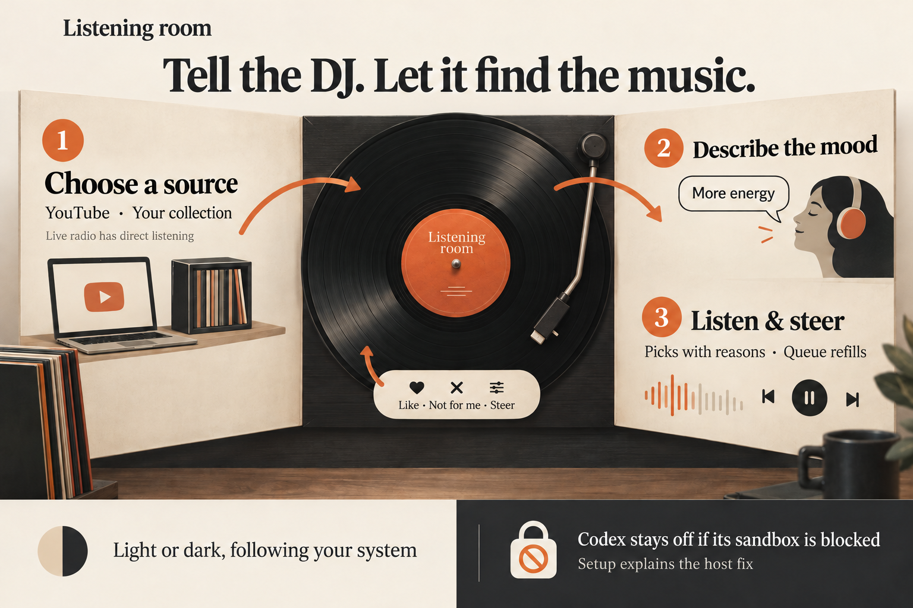
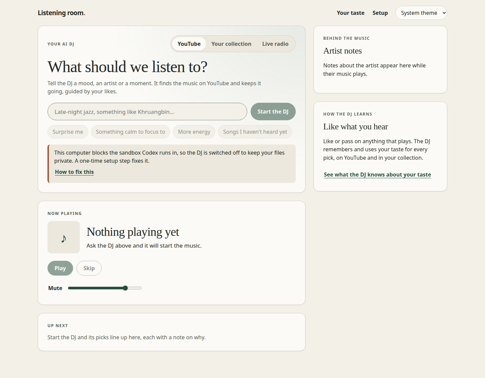
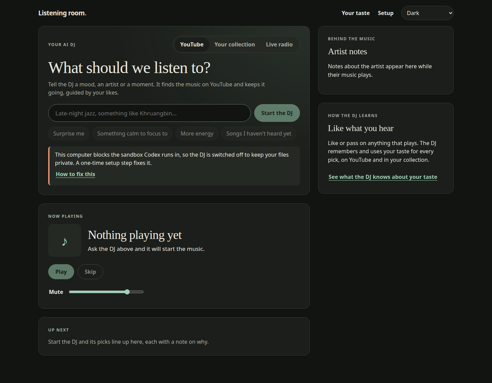
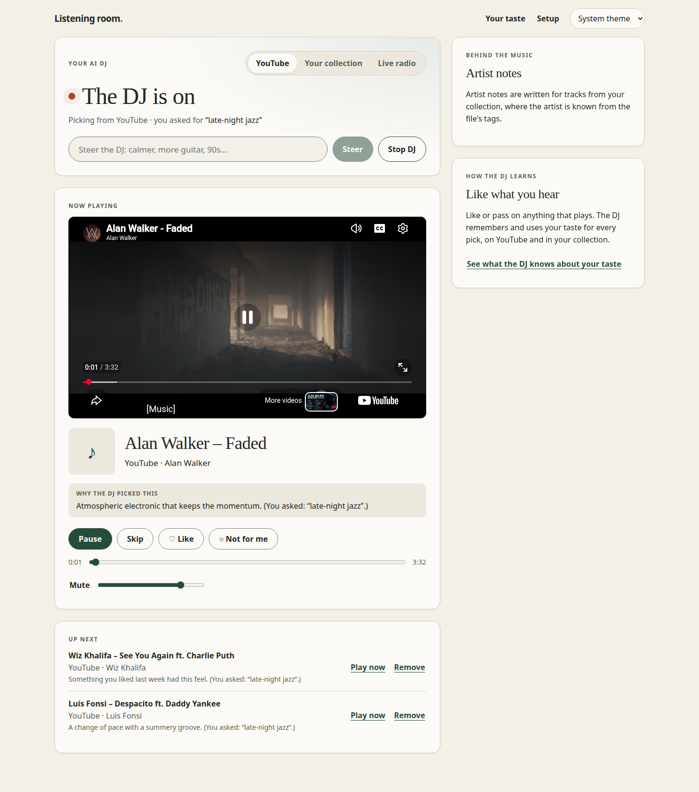
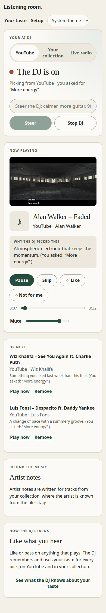
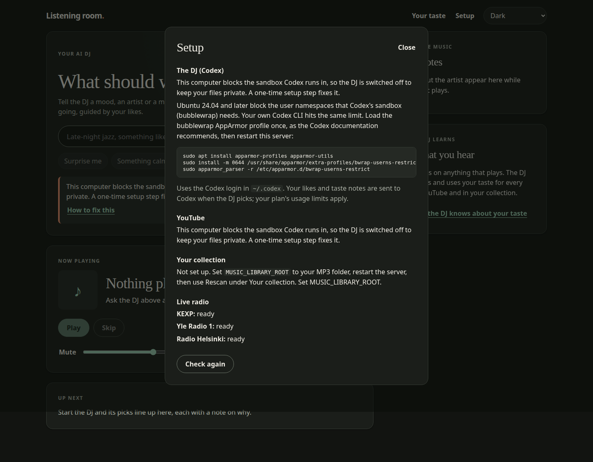

## TL;DR

Redesign Listening room around asking the AI DJ for music, with no YouTube link entry or manual YouTube search, and add light and dark themes that follow the system setting. Diagnose the host's Codex sandbox block with actionable setup instructions and select a model supported by the pinned CLI; the real DJ remains disabled on this host until that setup is applied.

What changed, verification and review guide

The [request](input/0001-task.md) asks for a complete redesign, system-aware dark mode and a fix for the Codex issue. The main screen now starts with a mood, artist or moment. For YouTube and the local collection, the DJ finds picks, explains each one, starts playback and refills the queue. People can steer, skip, give taste feedback or stop the DJ. Live radio has direct station listening, and local MP3 browsing remains available in a disclosure.

Themes use CSS `light-dark()` and `color-scheme`. A saved Light or Dark choice overrides the system setting and is applied before first paint. Setup and playback errors use readable messages.

Codex's startup check still fails closed. This host blocks bubblewrap's user namespaces through AppArmor, so the app reports `codex_sandbox_blocked` and shows the one-time host setup. Jobs also preserve the configured model when the pinned CLI lists it, otherwise selecting that catalog's preferred listed model and default reasoning effort. The app does not rewrite personal Codex configuration. Track changes now wait briefly for the playback lock to release, avoiding false “Another tab is playing” errors.

Review the DJ request, cancellation and queue flow in [main.tsx](../../../apps/web/src/main.tsx), theme tokens in [style.css](../../../apps/web/src/style.css), first-paint theme handling in [index.html](../../../apps/web/index.html), sandbox diagnosis and model selection in [codex.ts](../../../apps/server/src/codex.ts), and lock handling in [playback.ts](../../../apps/web/src/playback.ts). [Startup tests](../../../apps/server/test/codex-startup.test.mjs) cover the new diagnosis and model selection. The [README](../../../README.md) explains use and setup.

Typecheck, web tests, server reruns and build passed. Browser evidence covers desktop and 390px layouts in both themes and successful system-dark emulation. A mock API exercised the DJ controls and real embedded YouTube playback. Real Codex DJ discovery through playback is still unverified because applying the host fix needs sudo. This is the main limit for internal human testing; mock picks do not demonstrate recommendation quality. Phase reports below preserve the test failure, skipped boundary check and review coverage.

## Screenshots

Recorded from the built app during Work pass 1. These show the delivered product code; Gates later added only security-scanner ignores.

| System light, real server | Dark override, real server |
| --- | --- |
|  |  |

DJ playback, mobile layout and setup

**Desktop DJ playback — mock API, real YouTube embed.** The queue and explanations are fixtures, not real Codex recommendations.

**390px mobile — mock API, real YouTube embed.** System theme follows the emulated light setting.

**Setup — real server, dark theme.** The host block keeps the DJ off and the dialog explains the AppArmor setup. Full commands are also in the README.

## DJ-led listening

Ask for music and let the DJ find it; YouTube link entry and manual search are removed from the interface.

Listening flow and playback

YouTube and Your collection offer free text and idea chips. Picks include reasons in Now playing and Up next. The queue advances and requests more picks as it runs low. Steering replaces upcoming DJ picks while retaining manually queued local tracks. Stopping the DJ cancels pending work and removes its upcoming picks. Source changes cancel work, stop playback and clear the queue; session and source checks reject stale results.

Like and Not for me use the existing taste feedback flow. Local collection browsing is a secondary disclosure; Live radio retains direct listening. Direct YouTube resolution remains an API capability, but the UI no longer asks for links.

The playback controller waits up to one second to acquire the browser lock after releasing the preceding track's lock. Later browser evidence showed successful autoplay and Play now after the earlier false lock error was fixed. YouTube can still reject individual embeds; a recorded Skip encountered an unavailable video, and another pick played successfully.

## System-aware themes

The interface follows the system theme by default, with saved Light and Dark overrides.

Theme behavior and layout

Shared color tokens cover surfaces, text, controls, focus, errors and dialogs. The header selector saves the preference; the HTML startup script applies a pinned theme before React loads. System mode leaves color selection to the browser.

Browser checks covered desktop and 390px mobile in light and dark, with no horizontal overflow or console errors reported. System-dark emulation was explicitly confirmed with `matchMedia` and a body background of `rgb(18, 20, 17)`.

## Codex startup and compatibility

Explain why the sandbox cannot start and how to enable it, while keeping the boundary check required for AI routes.

Host diagnosis, model choice and remaining limit

The startup probe distinguishes known bubblewrap namespace failures from other boundary failures. The UI and README show how to load the bubblewrap AppArmor profile and restart the server. This change does not apply that host configuration or bypass the sandbox.

The pinned CLI rejects the user's configured `gpt-6.1-sol`. Model selection now reads `codex debug models`, respects the selected configuration profile and keeps a supported configured model. Otherwise it chooses the first visible model by catalog priority, with that model's default reasoning effort. An unreadable or empty catalog fails visibly. Work reported selection of `gpt-6-astra` against the real login, and earlier manual Codex turns succeeded, but the complete real DJ journey remains unverified.

The boundary probe tests allowed and sibling file reads, not complete process confinement. Work recorded that file, exec and other tools remain exposed despite disabled shell features; the sandbox remains essential. See the [tool-exposure finding](../../findings/20261015T115452Z-codex-music-jobs-still-expose-tools-to-the.md) for the scope left outside this change.

## Accumulated phase reports

Work pass 1 — implemented in ed09edc

Delivered the DJ-led redesign, theme selector and system default, readable errors, Codex namespace-block diagnosis and setup instructions, catalog-based model compatibility, and playback-lock race fix. Work judged fulfillment high-confidence, with visual taste the main subjective question.

Reported checks: root typecheck passed; server tests had 20 passes and one skip; web playback tests had five passes. New unit tests cover namespace detection, model selection and configuration-profile precedence. The real-boundary test skips with an explicit reason when this host blocks namespaces.

Browser work used the real server for the disabled state and Setup, and a temporary, uncommitted mock API for start, picks and reasons, autoplay, Like, steering, Skip and Play now. Both themes, desktop and 390px mobile were checked; system-dark behavior, no overflow and no console errors were reported. Earlier mock captures showed “Another tab is playing”; those observations predate the lock fix and are superseded by later successful playback evidence. Individual unavailable YouTube videos still produced errors.

Not done: real Codex DJ end to end, because the sudo host fix was not applied and the user could not be reached through the contact allowlist. Work performed its own review; separate evaluation and Gates review followed. A pre-existing server held the data lock and was left alone.

Evaluation pass 1 — good; no fixes

The evaluation lead reviewed the request and change summary, recorded light and dark desktop evidence on the real server, the mock DJ flow, and 390px mobile evidence in both themes. It opened three screenshots and searched `main.tsx` for leftover paste-link UI, finding none.

Judgment: the DJ-led redesign, system-aware dark theme and clear sandbox diagnosis meet the request for internal testing. No changes were made. Real Codex DJ end to end was not verified. Evaluation did not compare the attached before screenshot, reporting that it was unavailable in its task folder; the supplied attachment is linked in [the input record](input/0002-attachments.md).

Gates pass 1 — passed; final branch ed09edc then 5e7fdc0

Gates classified the change as high risk because it touches the sandbox startup check, spawns `codex debug models`, changes playback locking and redesigns most of the UI.

| Check | Reported result |
| --- | --- |
| Root typecheck | Passed. |
| Web adapter tests | Five passed. |
| Server tests | Initial failure at `codex-cancellation.test.mjs:25`: the existing fake-CLI startup wait expired after two seconds. Three reruns passed, each with 20 passes and one skip. Gates judged the timeout unrelated to this change. |
| Build | Passed. |
| Security | Initial scan found four DevSkim DS172411 timeout findings. Gates inspected them as arrow functions with fixed delays, recorded false-positive reasons in `.taiga/static-checks-ignore.toml`, and committed that file as 5e7fdc0. Rerun: zero open findings. Gitleaks and Checkov were clean. Other scanners had no applicable files and were skipped. |
| Review ranking | Incomplete automated ranking: `main.tsx` exceeded the size limit. Gates reviewed it manually. |

Gates reviewed fail-closed sandbox behavior, visible catalog failures, playback locking, DJ polling cancellation and stale-result checks. It found no HTML injection, leftover paste-link UI or defects. Its only change was the scanner-ignore file.

Gates reused Work's browser evidence; it did not repeat smoke checks. It did not run an additional full-test step because the fast step covered every suite, or a separate docs step because README was updated. The real Codex DJ remained unverified pending the host fix.

The [gate output record](gate-check-results.md) preserves the initial security and ranking failures; this later Gates report records their disposition. Product checks and browser evidence apply to ed09edc; 5e7fdc0 only adds scanner ignores. Release preparation changed only this task folder and did not rerun product checks.

