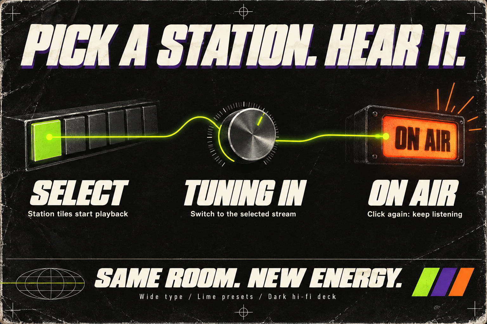
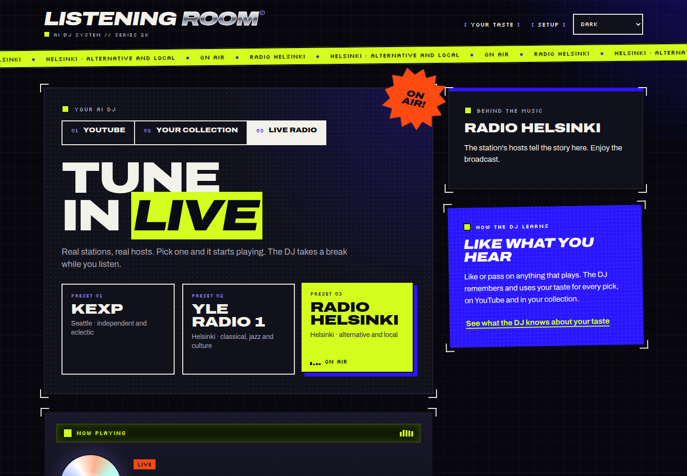
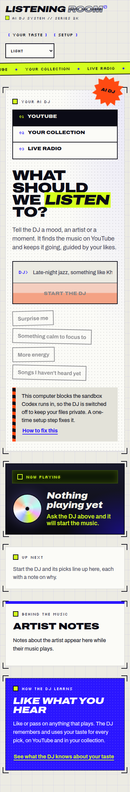

Listening Room gets an expressive early-2000s visual redesign, with wide type, acid lime radio presets and a dark hi-fi player. Selecting a station now starts its stream; selecting it again while it is connecting or playing keeps it running.

Explanatory illustration made with built-in imagegen; [generation prompt](implementation_summary/image-generation.md).

Change, verification and review guide

The request was to keep the existing UX, replace the generic UI with some “vimma,” and autoplay a selected radio station. The redesign applies that direction across the DJ booth, station presets, Now Playing, queue, artist notes, Setup and Your taste. Light, dark and system themes remain available.

Station tiles call `tuneIn`, which changes the source and uses the existing station-resolution and playback flow. A guard preserves the current stream when its tile is clicked while connecting or playing. Existing request IDs and source checks prevent a late resolution from overriding a newer selection. Opening the Live radio tab alone still leaves playback stopped. Browser autoplay restrictions can still require the existing Play fallback.

Start review in [main.tsx](../../../apps/web/src/main.tsx) for `tuneIn`, station states and decorative markup, and [style.css](../../../apps/web/src/style.css) for the visual treatment, responsive layout and reduced-motion rules. [The web manifest](../../../apps/web/package.json) and [lockfile](../../../package-lock.json) add two pinned OFL font packages, bundled locally rather than fetched from a font service at runtime. [README](../../../README.md) describes station autoplay.

Typecheck, web playback-adapter tests and the production build passed. Chromium checks covered radio autoplay and switching, repeat selection, Stop, desktop and phone layouts, both themes and Setup. The separate evaluation accepted both requested outcomes. The phase reports below distinguish those checks from the remaining gaps. Release preparation changed only this task folder and did not repeat app checks.

Readiness: **internal_testing**. Human approval should judge the visual direction. Firefox, Safari, real Codex DJ recommendations and a real MP3 collection remain unverified. Codex's sandbox is blocked on this host; DJ screens were exercised with a mock. The phone ask-field placeholder remains clipped.

## Screenshots

Desktop, dark theme: Radio Helsinki on air after selecting its tile. This capture predates the final phone-overflow adjustment; it documents the radio state and desktop design.

Phone, light theme: final capture after the overflow fix, with the real host's Codex sandbox message visible. The browser measured no horizontal scrolling in either theme at 390 px.

## Visual redesign

Wide Archivo headlines, Silkscreen labels, chrome lettering and lime, ultraviolet and orange give the existing listening flow a stronger identity.

What the new visual language changes

A tilted ticker repeats the current station or track. Crop marks, halftone surfaces, a changing starburst sticker, numbered source tabs, gloss buttons and sticker-style suggestions carry the early-2000s direction. Radio tiles resemble presets and turn lime when on air. Now Playing stays dark in both themes, with an LCD strip, animated disc fallback and custom slider fills. Up next uses outlined numbers; Setup and Your taste use period-inspired window styling.

The new decorative elements are hidden from screen readers, while existing labels and announcements remain. Reduced-motion rules stop animations. Archivo Variable 5.3.0 and Silkscreen 5.3.0 are bundled through Vite. The lockfile adds only those packages; the implementation report notes that a lockfile-only npm operation also removed unrelated `libc` fields, so the final edit retained only the intended additions.

## Station autoplay

Click a station to switch to it and start listening. Clicking the station already connecting or on air does not reconnect it.

Playback behavior and evidence

`main.tsx` adds `tuneIn`; `playback.ts` is unchanged. `tuneIn` checks the current source and pending, loading or playing state, then calls `changeSource` and `listenRadio`. Resolution failures still appear on the selected station. The UI distinguishes “Tuning in…” from “On air”; the deck's LIVE state follows the player's `playing` event.

On the real app in Chromium, selecting KEXP reached CONNECTING and then LIVE in about seven seconds without pressing Listen live. Selecting Radio Helsinki reached LIVE in about one second. Selecting Radio Helsinki again stayed LIVE throughout four seconds of 250 ms polling. Stop returned to OFF AIR. No console or page errors were reported. The browser found no attached media elements; the implementation's event-driven LIVE state was the playback evidence. There is no component test for station clicks in `main.tsx`; the existing adapter suite and this browser check provide the evidence.

## Accumulated phase reports

Work pass 1 — implemented

**Delivered:** station-click autoplay and repeat-selection protection; a full visual redesign across the existing sections and controls; local display fonts; light, dark and system themes; reduced-motion support. The worker judged autoplay to match the request and the redesign to be bold, leaving its “vimma” to the evaluator and user.

**Checks:** typecheck, build and `tests-web-adapters` passed. Real-app Chromium checks covered KEXP, Radio Helsinki, repeat selection and Stop. Visual inspection covered desktop dark and light start screens, radio on air and Setup; mock DJ playback and queue screens; and phone dark and light screens, including the real sandbox-blocked message. No console errors were reported.

**Repairs during work:** fixed headline breakout, short full-page backgrounds, phone horizontal overflow of 2–5 px, and oversized phone ask-field text. Earlier captures showing those problems are historical. Final phone checks measured `scrollWidth = clientWidth = 390` and `scrollX = 0` in both themes. Desktop radio evidence predates that phone adjustment; gates accepted it as applicable without repeating the journey.

**Review and security:** the worker read its own diff; there was no separate code reviewer in this phase. It reported no new network calls, inputs or APIs. Two font dependencies were added. Server tests were omitted because server code did not change.

**Limits:** Chromium only; Firefox and Safari rendering, including range sliders, `@property` with `light-dark()` and text clipping, was not checked. Real Codex DJ picks were blocked by the host sandbox, and no real MP3 library was configured. Stricter browser autoplay rules may require Play. Mock DJ testing accidentally produced audible music; playback and the mock were stopped, later checks stayed silent, and the testing precaution was saved to project memory.

Evaluation pass 1 — good

The evaluator read the request and diff, including `tuneIn`, the stylesheet rewrite and font packages. It reviewed three screenshots across desktop and phone sizes and both themes, plus the autoplay browser record. It judged both requests met and made no changes.

Firefox, Safari, real Codex picks and the collection view with a real library were not verified. The clipped phone placeholder was judged cosmetic. This was a separate result-quality evaluation, not an additional automated test run.

Gates pass 1 — passed after resolving one scanner finding

Gates judged the change medium risk because it changes station clicks, rewrites the stylesheet and adds fonts; it changes no server code, stored data or sign-in.

| Check | Final reported result |
| --- | --- |
| Typecheck | Passed on the final checkout |
| Web playback-adapter tests | Passed on the final checkout |
| Production build | Passed on the final checkout |
| Lint and formatting | No project operations exist |
| Static security checks | Rerun reported zero open findings after one ignore |
| Automated review ranking | No committed diff to rank; gates chose review order manually |

The [saved initial gate output](gate-check-results.md) records the **earlier failure**, not the final scanner result: DevSkim DS162092 flagged the existing Vite `dev` script in `apps/web/package.json`. Gates recorded it as a false positive because the shipped build runs TypeScript and Vite build, then reported a clean rerun. The reason is retained in [the scanner ignore file](../../static-checks-ignore.toml). Gitleaks, Checkov and Trivy reported no open findings. Bandit, Gosec, PMD, Psalm and Zizmor had no applicable files and were skipped; they provide no coverage here.

Gates reviewed stale station responses, resolution errors, repeat selection, slider bounds, font versions and licenses, and screen-reader treatment. It confirmed that existing request checks reject late resolutions and that seek fill is rendered only when duration is known. No automated component test covers station clicks.

Gates added the README autoplay sentence and the scanner ignore, with no product-code changes. It reused the passing fast build rather than running another build, reused earlier browser evidence rather than repeating smoke tests, and omitted server tests because no server or shared code changed. [The gate selections](gate-checks.json) record those choices. The earlier work and evaluation evidence therefore remains applicable with the timing limits described above; browser coverage was not broadened.

Outstanding: Firefox and Safari, real Codex DJ picks, a real music collection, and the cosmetic phone placeholder clipping.

