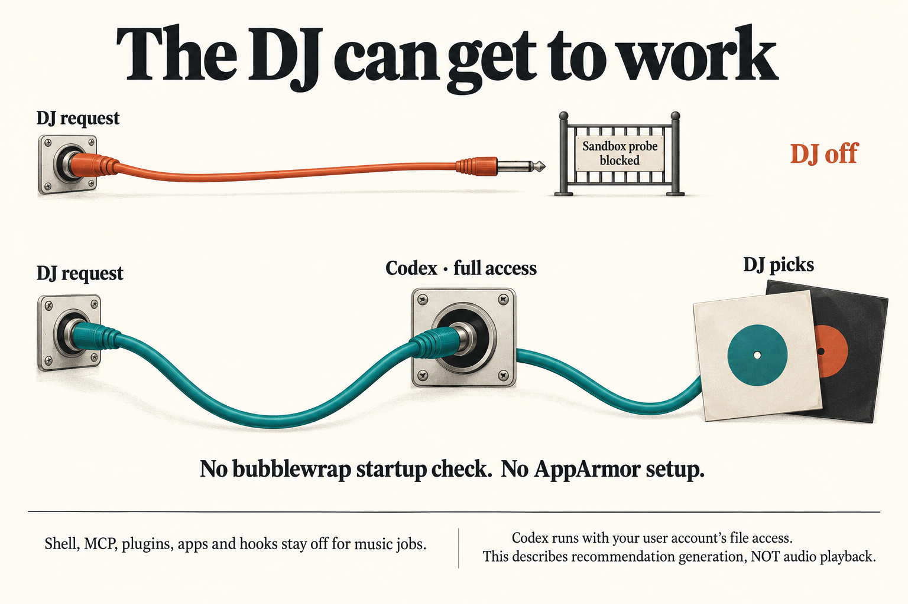
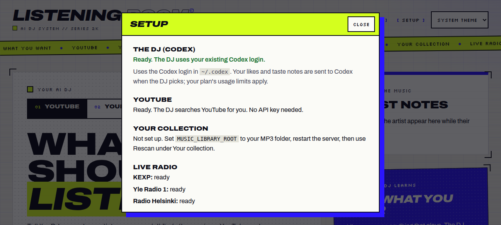

**TL;DR:** Music jobs now run Codex with full access, and the sandbox startup probe is removed. The DJ returns picks on this Ubuntu host without sudo or AppArmor setup, as the owner requested.

Change, verification and review guide

The [request](input/0001-task.md) asks that sandbox restrictions stop preventing the DJ from working. Previously, startup tested a custom filesystem permission profile through bubblewrap. This host blocks the user namespaces bubblewrap needs, so the test disabled the DJ before it could generate recommendations.

The worker now starts every music thread with `sandboxMode: 'danger-full-access'` and the existing `approvalPolicy: 'never'`. The custom `music_agent` filesystem and network overrides, startup boundary probe and related error handling are removed. CLI version, existing-login and model-catalog checks remain. Shell tools, MCP servers, plugins, apps and hooks remain disabled for music jobs; these settings do not provide filesystem confinement. Codex can read and write anything the user account can, by the owner's explicit choice.

Start review with [the worker](../../../apps/server/src/codex-worker.mjs) and [CodexRunner](../../../apps/server/src/codex.ts), then [startup tests](../../../apps/server/test/codex-startup.test.mjs). The [UI](../../../apps/web/src/main.tsx) and [README](../../../README.md) remove the obsolete sandbox recovery instructions. Tests also update the [cancellation fixture](../../../apps/server/test/codex-cancellation.test.mjs) for the new thread option.

Work pass 1 verified the final application code against real Codex 0.156.1: capabilities reported Codex and YouTube discovery ready, and a real YouTube recommendation job returned two picks. A muted browser check showed the ready status below. Gates passed the type check, server and web-adapter suites, build and branch review. The only later committed change updated a project memory note; application code did not change after these checks. This release step adds only task-folder documentation and images and does not rerun application checks.

The delivered result meets **internal_testing** readiness according to Work and Gates. Local-library recommendations remain unverified because `MUSIC_LIBRARY_ROOT` is unset. Taste synthesis and artist information share the Codex path but were not exercised separately.

### Screenshot

Setup after the change: Codex and YouTube are ready. The browser muted existing media, activated no playback controls and then navigated away. This screenshot confirms the Setup status; the separate real-server job established that recommendations returned picks.

### Codex execution

**TL;DR:** Music jobs bypass the sandbox, so bubblewrap cannot prevent the DJ from starting.

Runner behavior and tests

The SDK thread explicitly selects full access. `executionOverrides` keeps the existing music-job configuration overlays but no longer defines or selects the restrictive permission profile. Startup no longer creates synthetic allowed and sibling files or invokes `codex sandbox` to test them. Native CLI resolution, personal model selection and catalog fallback continue to work as before.

Startup tests now reach the existing-login check on this host instead of skipping when namespaces are blocked. The configured-MCP test still checks that the pinned CLI sees personal MCP servers disabled without rewriting the user's config. Cancellation and scratch cleanup paths are unchanged.

### Setup and documentation

**TL;DR:** Setup no longer directs the owner to repair AppArmor to use the DJ.

Visible behavior and guidance

The UI removes the three sandbox error translations and conditional sudo instructions. Existing login and other capability errors still use their normal messages. The README replaces the sandbox setup procedure with the deliberate full-access behavior. Gates also corrected the [project memory note](../../memory/topics/music-agent-sandbox-and-ui-testing.md), which previously told future agents that this host required an AppArmor fix.

### Accumulated phase reports

Work pass 1 — implemented

**Delivered:** Commit `cffe7a4` added full-access Codex threads, removed permission-profile overrides and the startup sandbox check, removed obsolete UI errors and AppArmor help, updated the README and tests, and kept shell, MCP, plugins, apps and hooks off. Personal model selection and catalog fallback remain.

**Judgment:** Work reported that the request was fulfilled at internal_testing readiness: the real DJ worked on this host without sudo or AppArmor setup.

**Verification:** `build`, `typecheck` and `tests-server` passed, with 20 server tests passed and none skipped. A real server used Codex 0.156.1 and a copy of the data. `/api/v1/capabilities` reported Codex and YouTube discovery ready; a real YouTube DJ recommendation job succeeded with two picks. A muted Setup walkthrough showed the ready message with no sandbox text and played nothing. The runner's web service, restarted on final application code, also reported Codex ready.

**Review and security scope:** No separate code review was done in this phase. Full user-account access was the owner's choice; no other security work was done.

**Limits:** Local-library recommendations were not tested because `MUSIC_LIBRARY_ROOT` was unset. Taste synthesis and artist information were not run separately. This evidence still applies to the final application code.

Gates pass 1 — passed

**Risk and judgment:** Gates classified the change as high risk because it changes Codex process permissions, explicitly requested by the owner. No defects were found.

| Check | Result | Coverage |
|---|---|---|
| `typecheck` | Passed | Application commit `cffe7a4` |
| `tests-server` | Passed | Application commit `cffe7a4` |
| `tests-web-adapters` | Passed | Application commit `cffe7a4` |
| `build` | Passed | Application commit `cffe7a4` |
| `taiga review --branch` | Passed; no smells | Application commit `cffe7a4` |
| Documentation | Done | Memory correction `c433bca` |

**Code review:** Gates read the complete diff of `codex.ts`, `codex-worker.mjs` and `main.tsx`, checked `executionOverrides` callers, removal of probe references and error codes, retained tool settings, cancellation and cleanup. The [saved gate results](gate-check-results.md) contain the branch review output.

**Checks not repeated or not done:** Gates relied on Work's real Codex and muted browser smoke checks rather than repeating them. No additional full-test run was needed because the fast checks already covered the complete suites. The repository has no lint or format scripts. No security scan ran: the permission expansion was requested, and the change added no dependencies or input handling. This is not evidence of process confinement; Codex has full user-account access.

**Later correction and freshness:** Gates updated only the stale sandbox memory note in `c433bca`; application checks were not repeated after that documentation change and remain applicable. Local-library, taste-synthesis and artist-information limits from Work remain unresolved.

Evaluation was disabled for this run; there is no separate Evaluation contribution.

Image provenance

The Setup image was copied from the runner browser's Work pass 1 evidence capture `capture-85561073b97c4782a97b4646c1223eba.png`. The infographic was generated with the built-in image generation tool using the [saved prompt](implementation_summary/infographic-prompt.txt). Both saved images were opened and checked for readability during release preparation.

