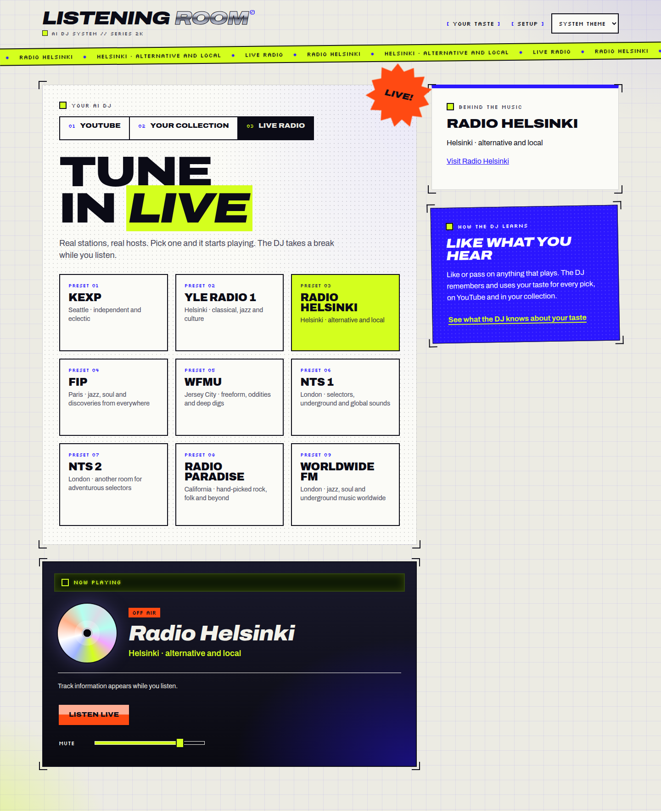
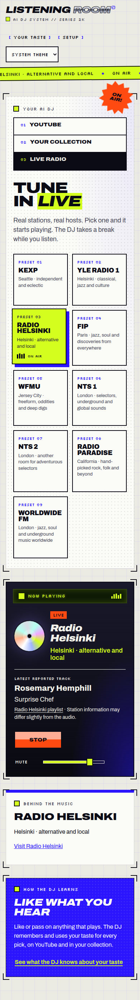

## TL;DR

Live radio grows from three to nine curated presets, adding FIP, WFMU, NTS 1 and 2, Radio Paradise Main Mix and Worldwide FM. While listening, the player shows station-reported tracks or programmes where available, with source attribution and explicit missing or expired states that leave playback running.

What changed, how it works and where to review

The [request](input/0001-task.md) asked for more stations at the editorial level of Radio Helsinki, KEXP and Yle Radio 1, plus now-playing information where possible. The additions favour independent presenters, freeform discoveries, jazz, global music and culture. The [station research](station-sources.md) explains each choice and records stream and feed provenance.

Station IDs, labels, descriptions and websites now share a catalogue. The server resolves the nine streams and exposes `GET /api/v1/stations/:id/now-playing`. Provider adapters preserve the distinction between a reported song and an on-air programme. The browser refreshes while listening, clears expired titles independently of refresh completion, and cancels polling on Stop or retune. Metadata errors do not interrupt audio.

Start review with the [shared catalogue and response schemas](../../../packages/contracts/src/index.ts), [stream definitions](../../../apps/server/src/stations.ts), [metadata service](../../../apps/server/src/station-now-playing.ts), [browser polling](../../../apps/web/src/radio-metadata.ts) and [player integration](../../../apps/web/src/main.tsx). The [README](../../../README.md) documents API semantics and operational limits. Regression coverage lives in the [server station tests](../../../apps/server/test/stations.test.mjs) and [browser metadata tests](../../../apps/web/src/radio-metadata.test.mjs).

Final gates passed the contracts build, workspace typecheck, all 32 server tests, all 10 web adapter tests, shipping build and whitespace check. Managed browser checks covered all nine streams, real metadata, missing and expired data, stalled refreshes, retune races, Stop and desktop/mobile layouts. See the phase reports below and [verification record](verification.md) for scope and history.

Ready for **internal human testing**. Public streams and mostly undocumented feeds can change; Radio Helsinki's HTML can refuse automated access. KEXP supplies the latest logged track rather than an exact end time. Yle Radio 1, WFMU and Worldwide FM have no metadata adapter. Human audibility and final personal taste remain for human approval. No persistent data migration or dependency change is required. The existing build chunk-size warning remains.

## Screenshots

Final desktop layout at 1440px, with all nine presets and playback stopped:

Mobile capture at 390px, showing real Radio Helsinki metadata, its source link and compact two-column presets. The later desktop font adjustment retained this mobile styling; the final build also received a desktop inspection. At 320px, presets use one column.

These are copied from the managed browser's evidence. The infographic above is a conceptual illustration, not an application screenshot.

## Curated stations and shared definitions

Six additions broaden the original selection while keeping each station's identity and editorial character visible.

Selection and catalogue changes

| Addition | What it adds |
| --- | --- |
| FIP | Jazz, soul and discoveries from around the world. |
| WFMU | Listener-supported freeform radio, oddities and deep digs. |
| NTS 1 and NTS 2 | Two channels of adventurous, presenter-led selections. |
| Radio Paradise Main Mix | A human-mixed blend of rock, folk, electronic and global music. |
| Worldwide FM | Jazz, soul, underground music and independent scenes worldwide. |

The shared catalogue feeds labels, station notes, station IDs and frontend choices. Server capability reporting derives from station descriptors. Stream provenance remains explicit, including third-party discovery for FIP, NTS and the existing Yle stream; configured availability is not a live health guarantee. Existing overrides for the original three stations remain supported. The expanded preset grid uses whole-word wrapping and compact mobile cards. Each station panel links to the station's site.

## Station reports and playback lifecycle

Now-playing data is attributed, expires promptly and stays separate from the audio stream.

Providers, freshness and failure handling

| Station | Report shown |
| --- | --- |
| Radio Helsinki | Current song and artist, or programme, from public HTML fields. |
| KEXP | Latest logged track, accepted for at most 15 minutes after its start. |
| FIP | Track matching the feed's current start/end interval. |
| Radio Paradise | Track with its reported remaining duration. |
| NTS 1 and NTS 2 | Programme matching the current schedule interval. |
| Yle Radio 1, WFMU, Worldwide FM | Explicit unsupported message. |

Responses distinguish `current`, `unavailable`, `stale` and `unsupported`. Custom stream overrides disable metadata so a replacement stream cannot inherit another broadcast's report. Current records carry a title, optional artist and start time, observation and expiry times, kind and attribution URL.

The server uses fixed HTTPS provider URLs, rejects redirects, validates response types and parsed fields, limits bodies to 512 KiB and applies an eight-second deadline. A 30-second cache shares concurrent work per station. Reports expire within 90 seconds of observation or sooner at a supplied end time. HTTP age reduces undated or relative-duration freshness; NTS and FIP use explicit intervals, allowing a cached schedule to remain useful during its valid programme.

The browser polls at 30-second intervals after requests complete, clears expired text even if the next request stalls, ignores stopped or previous-station responses, and removes timers on cleanup. Unsupported responses end polling. Titles render as text. The UI distinguishes programmes from tracks and explains that station reports can differ slightly from buffered audio.

## Work, Evaluation and Gates reports

All three phases accepted the result for internal testing. The following preserves their contributions and distinguishes repaired findings from final evidence.

Work pass 1 — implemented

Delivered nine presets, metadata adapters, source attribution, bounded caching and requests, explicit missing/expired states, safe Stop/retune handling, shared definitions and responsive presets.

Runner verification passed the final build, workspace typecheck, 32 server tests and 10 web tests. Live API checks exercised all nine stations and invalid IDs. Managed browser checks confirmed every stream reached playback, real track/programme information appeared, missing or expired metadata left audio working, delayed old-station responses were ignored and Stop ended polling. Desktop and mobile captures were inspected at 1440px, 390px and 320px.

Earlier checks found a native browser timer receiver crash, incorrect handling of NTS cached schedules and preset label overflow. These were repaired and affected checks passed afterward. Earlier screenshots and behavior before those repairs are historical, not final acceptance evidence. The verification record identifies subsequent behavior checks and final layout captures.

The implementation session inspected the final diff and security boundaries: fixed HTTPS URLs, redirect rejection, response limits, deadlines, validation and safe text rendering. No dependencies changed. This session did not perform an independent code review or separate security audit. Public feeds, Helsinki HTML, KEXP timing and missing adapters remain the limits described above; human audibility and final taste were not verified. No known assigned defects remained.

Evaluation pass 1 — good

A separate evaluation judged the full requested outcome, station rationale, application diff, four new source/test files and recorded playback/metadata behavior, and personally inspected desktop/mobile screenshots. It accepted the editorial selection, metadata semantics, fallback experience and final appearance for internal testing.

The evaluator confirmed that the timer crash and desktop overflow had specific repairs and successful subsequent evidence. It made no changes, so it invalidated no implementation evidence. It did not run new tests, routine code review, a security audit or a human audibility check. Public feed availability, the three unsupported metadata stations and final personal taste remained limits rather than blockers.

Gates pass 1 — passed

Gates treated this as high risk because it adds network access, untrusted feed parsing, shared contracts and concurrent polling. Current-checkout checks passed: contracts build, workspace typecheck, all 32 server tests, all 10 web adapter tests, shipping build and `git diff --check`. No lint or format checks are configured. No extra full suite was needed because those checks ran all available tests.

Static security checks finished with zero open findings and five reasoned false-positive ignores. Gitleaks, DevSkim and Checkov completed; inapplicable scanners skipped. The ignores cover intentional loopback Host validation and server binding, Vite's development-only loopback address, a fixed expiry callback with validated expiry capped at 90 seconds, and a fixed polling callback with a constant delay. Ignore explanations were revised after the scanner matched text inside the explanations themselves.

The [initial gate output](gate-check-results.md) retains the first security failure and a ranking helper that found no committed implementation files. Those are historical results: the final phase report records the resolved scan at `/home/jp/.local/state/taiga/static-checks/d2a9c640780b49f28b37d9b840320ac8`, with the explanations in the [committed ignore file](../../static-checks-ignore.toml). The ranking helper's result was not treated as code-review evidence. Manual close review explicitly included uncommitted implementation against the run base.

That close review covered every changed product file and surrounding consumers, using Oracle to confirm callers, saved-source compatibility, DJ isolation and playback lifecycle. It reviewed fixed-provider boundaries, validation, bounded shared caching, deadlines, visible errors, cancellation, timer cleanup and partial failures, and required no application-code repairs. README clarifications and scanner reasons were committed as `ab7c7c1`; implementation remained uncommitted for Factory delivery.

Gates did not repeat browser smoke because existing final-code checks covered nine streams, real metadata, expiry during stalled refresh, unavailable responses, old-station rejection, Stop and final layouts. No application code changed during gates, so that evidence and the earlier evaluation remained applicable. No paid model tests, independent penetration test or human audibility check ran. No migration or known assigned work remained.

