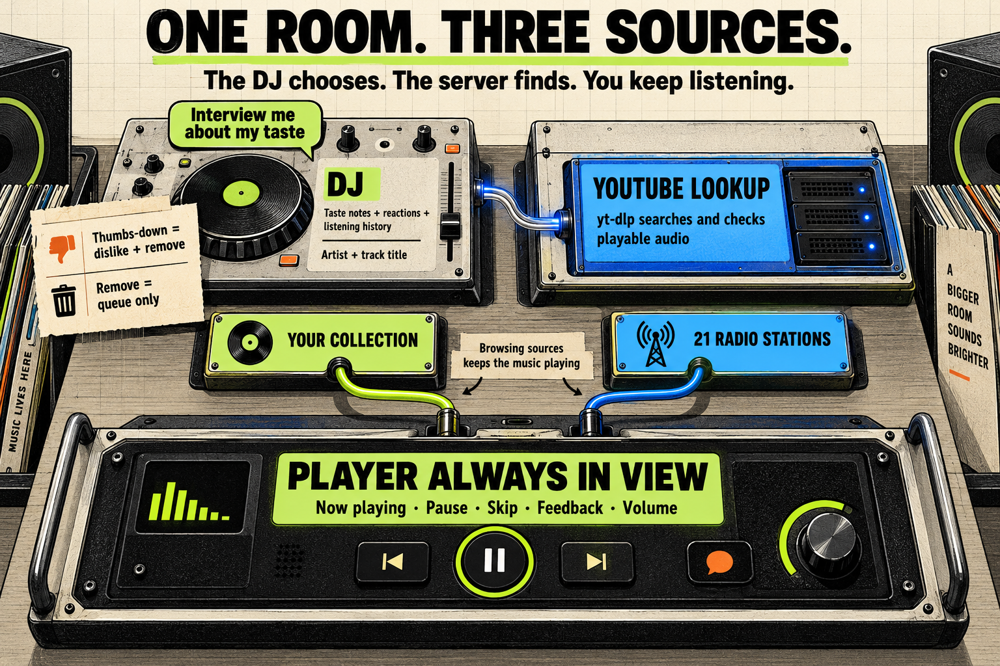
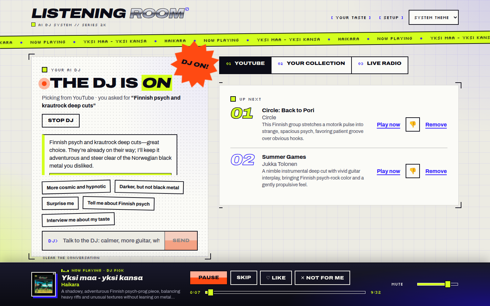
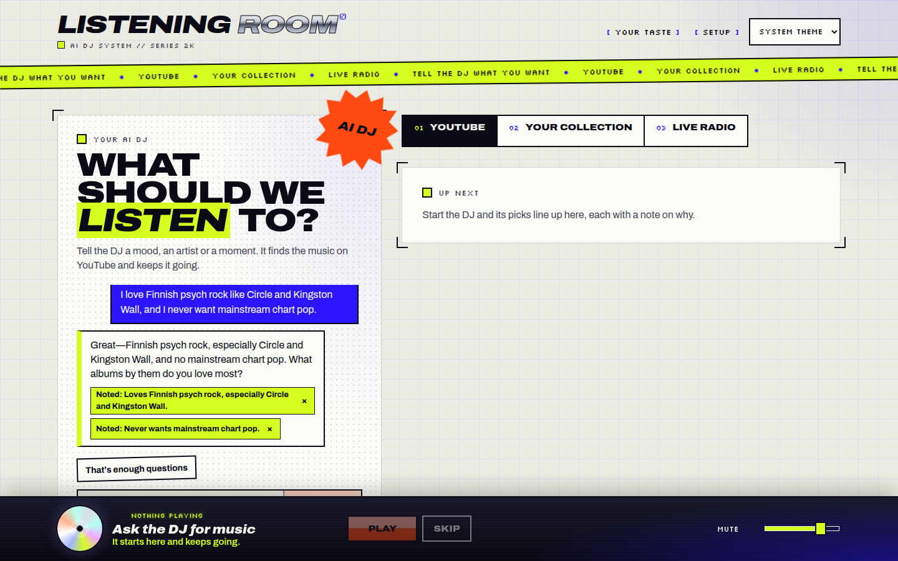
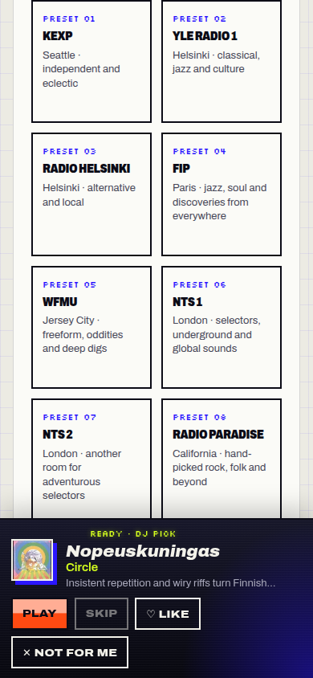

Music-agent now keeps playback controls in view, plays YouTube audio through yt-dlp, and lets listeners steer a DJ that remembers their taste. Source browsing preserves playback, queue dislikes teach the DJ, and the radio selection grows from nine to 21 stations.

How the change works, verification and review guide

Reliable playback is the priority. Codex now names artists and tracks without web search; the server searches YouTube, ranks matching recordings and checks that audio opens before queuing them. A local audio proxy replaces the YouTube iframe. The listening room pairs a DJ conversation with source panels and a fixed player, so ordinary listening needs less scrolling.

The DJ uses explicit reactions, conversation notes and recent listening when choosing music. Its instructions favor the listener's stated taste and deep cuts over defaulting to mainstream hits. This is prompt and context behavior, not a guarantee about every recommendation.

Start review with [YouTube lookup](../../../apps/server/src/youtube.ts), [yt-dlp management](../../../apps/server/src/ytdlp.ts), [DJ decisions](../../../apps/server/src/dj.ts), [listening state and source switching](../../../apps/web/src/main.tsx), and the [player](../../../apps/web/src/player-bar.tsx). [README](../../../README.md) covers setup, APIs and data storage; [.env.example](../../../.env.example) documents the optional yt-dlp override.

**Readiness: internal testing.** Evaluation judged the result good. Gates passed at high risk: types, server tests, web adapter tests and build passed; security findings were reviewed and the final scan had no open findings. Browser evidence covers real YouTube audio, seeking, skipping, feedback, interviews, radio and phone layouts. All browser playback was muted, so audible output has not been checked by ear. External YouTube restrictions, extractor changes and station outages remain possible.

The accumulated phase reports and their limits are retained below. This release step only writes documentation and images in this task folder; it does not change the product or repeat the gates.

### Screenshots

Desktop listening: DJ conversation, upcoming picks with separate dislike and Remove actions, and the docked player.

Taste interview: the DJ saves the listener's Finnish psych preferences and rejection of mainstream chart pop as visible notes.

Phone radio browsing after the layout fixes: the player stays visible while the stations scroll.

### YouTube playback

The DJ chooses recordings; yt-dlp finds and streams them through the local server, without an iframe fallback.

Lookup, stream recovery and setup

[DjService](../../../apps/server/src/dj.ts) requests artist and title pairs, then performs bounded concurrent lookups. Matching favors Topic and artist channels and penalizes unwanted versions and whole albums. Only candidates whose audio opens enter the queue. Quick batches target three tracks; refills target five. Recent songs are excluded, and a dislike arriving during selection filters the batch.

[YoutubeService](../../../apps/server/src/youtube.ts) caches expiring stream URLs and refreshes refused requests. The [media route](../../../apps/server/src/index.ts) proxies range requests; [PlaybackController](../../../apps/web/src/playback.ts) uses an audio element and can reconnect twice at the previous position after a mid-track error.

The server installs the official yt-dlp zipapp under the data directory after checking the release SHA-256 checksum. Managed updates wait for active extractor processes to finish. Python 3.10+ and network access are required; `MUSIC_YTDLP_BIN` selects an independently managed copy. Setup reports readiness and version.

Recorded implementation evidence includes an embed-blocked video served as ranged audio, advancing playback time, seeking to 120 seconds and skipping. Those measurements describe the implementation test environment, not a general playback guarantee. Review [YouTube tests](../../../apps/server/test/youtube.test.mjs), [extractor tests](../../../apps/server/test/ytdlp.test.mjs) and [playback tests](../../../apps/web/src/playback.test.mjs).

### Listening controls and source switching

Now playing stays at the bottom; switching source tabs keeps the current audio playing and preserves the DJ session.

Layout and source behavior

Wide screens use independently scrolling DJ and source columns. The page reserves the measured player height; the phone layout keeps the player docked. Media Session integrates system controls. UI components are split into [DJ panel](../../../apps/web/src/dj-panel.tsx), [source panels](../../../apps/web/src/panels.tsx), [dialogs](../../../apps/web/src/dialogs.tsx) and [player bar](../../../apps/web/src/player-bar.tsx), while listening state remains in `main.tsx`.

Changing between YouTube and collection replaces the DJ's upcoming picks, retains manually queued entries and leaves the current track playing. Opening Live radio only browses stations. Selecting a station replaces the current audio while retaining the DJ queue. Back to the DJ plays the next queued pick. The browser journey verified that return with a nonempty queue; the empty-queue case was not established by that journey.

### Taste, conversation and feedback

Listeners can talk to the DJ, answer an interview and remove saved notes. Queue thumbs-down records a dislike; ordinary Remove only edits the queue.

What the DJ learns and remembers

The playing track's Not for me records a dislike and skips. Queue dislikes remove the item and offer Undo. Finished and skipped tracks become listening context, with skips treated as weaker signals than explicit dislikes.

[DjMemory](../../../apps/server/src/memory.ts) saves up to 60 notes, 80 messages and 300 listening events with serialized atomic writes. Invalid saved contents are moved aside. Your taste exposes notes with Forget; clearing the conversation retains notes. [Contracts](../../../packages/contracts/src/index.ts) define the conversation and listening APIs.

Conversation can return a direction that steers the music. Interviews ask one question at a time and can offer answer chips. Two Codex jobs can run concurrently, with waiting conversation jobs prioritized; conversation and quick YouTube picks use a small catalog model when available. Notes, reactions and recent listening are included in model context, as documented in the README.

The real interview saved the requested preferences and displayed them in Your taste. It sometimes produced no answer chips despite the prompt requesting them; that remains a known UX limit. The queue thumbs-down remains an icon without a visible text label.

### Radio

Twelve added stations broaden the selection to 21, with more independent, international and experimental programming.

Stations and now-playing information

The additions are dublab, Refuge Worldwide, Radio 80000, Cashmere Radio, Noods Radio, Resonance 104.4 FM, Radio Nova, Radio Meuh, Ö1, WWOZ, Intergalactic FM and Radio Swiss Jazz. [Station definitions](../../../apps/server/src/stations.ts) include descriptions and stream provenance.

[ICY metadata support](../../../apps/server/src/station-now-playing.ts) adds track reports for Radio Meuh, Intergalactic FM and Radio Swiss Jazz, and show reports for five other additions. Metadata failure does not stop audio. Stations without useful feeds report that limitation.

Implementation records say all twelve additions played in muted Chromium. SomaFM Drone Zone failed on both tested relays and was dropped; its earlier failure is historical evidence, not a failing preset in the final list. The later phone check covered all 21 station labels without mid-word splitting.

### Accumulated phase reports

The work phase has no recorded closing report. Evaluation judged the result good for internal testing. Gates reported passed at high risk.

Work pass 1 — implementation records

No Work contribution was recorded. [Iteration notes](iteration-notes.md) supply implementation evidence: audio proxy and extractor setup, muted playback and seeking, source browsing without interruption, queue dislike and player skip behavior, persisted interview notes, twelve added stations and ICY metadata. [Plan](plan.md) records the shared choices, including no iframe fallback, managed yt-dlp and separate track choice and lookup. It also records remaining debt: `main.tsx` still owns listening state in one component.

The [journey report](implementation_summary/journey-report.md) predates removal of Drone Zone. An earlier layout report found 15 pixels of phone overflow; [later radio and phone checks](implementation_summary/radio-and-phone-report.md) measured none, and [final station-label checks](implementation_summary/final-phone-report.md) confirmed the label repairs. The [interview report](implementation_summary/interview-report.md) records successful notes and missing chips. Browser checks predate the final English-default prompt change and were not repeated after it.

Evaluation pass 1 — good for internal testing

The evaluator made no code changes. Scope: original request, final 21-station list, interview prompt, chip logic, desktop playing screenshot and recorded journey, interview, stream and phone checks. The result was judged **good** for internal testing.

Remaining gaps: interview chips depend on Codex output and may be absent; queue thumbs-down has no visible text label; no one listened to the audio because browser checks were muted. This was an assessment of recorded evidence, not an independent audible playback check.

Gates pass 1 — passed at high risk

The final branch passed `typecheck`, `tests-server`, `tests-web-adapters` and `build`. The two saved suites constitute the project's whole test set. No lint or format script exists, so none ran. Gates did not repeat browser smoke checks: recent muted journeys covered the product before the later one-line prompt change. No separate docs check ran; README and environment documentation were reviewed as already updated.

The initial static scan found three low-severity DevSkim timer findings in `codex.ts` and `main.tsx`. Gates inspected all three: fixed numeric delays and arrow-function callbacks made them false positives. The ignore reasons were committed as `1764f78`; the reported rerun had zero open findings. Gitleaks and Checkov were clean. Bandit, Gosec, PMD, Psalm, Trivy and Zizmor had no applicable files and were skipped. [Gate results](gate-check-results.md) preserve the initial failed scan and incomplete ranking; they predate the reported clean scan rerun. [Gate choices](gate-checks.json) explain checks not repeated.

Review ranking exited 1 because it could not score `main.tsx` and `.env.example`; ranking was partial. Gates manually reviewed `ytdlp.ts`, `youtube.ts`, `memory.ts`, changed routes in `index.ts` and the flagged timer lines in `codex.ts` and `main.tsx`, finding no defects. Security review covered loopback binding and Host/Origin restrictions, extractor execution without a shell, separated arguments and validated video IDs, deadlines and process termination, checksum-checked atomic installation, Google video stream host checks, proxy disconnect cleanup, and serialized atomic memory writes that preserve invalid contents separately.

Remaining uncertainty: audible output was never checked; chips may be absent; external streams can fail. The gates report mentioned the earlier Drone Zone failure; implementation records confirm it was subsequently dropped. The web service must restart after a build because static routes register at startup; this behavior predates the change. The delivered app should be restarted before internal testing.

