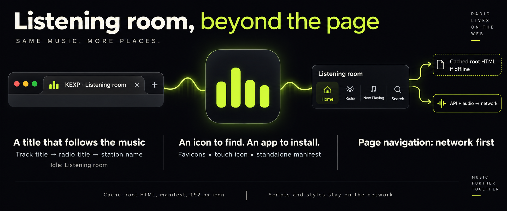
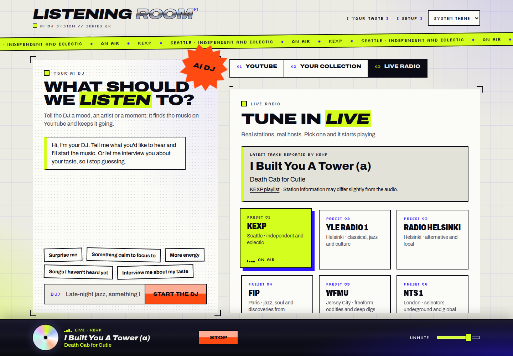

TL;DR: Listening room now has matching favicons and app icons, a browser title that follows the selected track or radio station, and a manifest and service worker for browser installation.

*Conceptual infographic, generated with the native image tool; the app illustration is not a product screenshot. [Generation prompt](implementation_summary/infographic-prompt.txt).*

What changed, verification and review guide

The [request](input/0001-task.md) asks for favicons, now playing in the browser title, and PWA support. The frontend now supplies a lime equalizer icon family, shares its playback title with the browser tab, and registers a small service worker. The manifest requests a standalone window with the Listening room name and dark theme colour.

The worker handles same-origin GET page navigations with network first and cached root HTML on network failure. It precaches only `/`, the manifest and the 192 px icon. Scripts and styles are not precached, so this does not establish a complete offline app launch or offline playback. API requests and audio bypass its cache.

Review [index.html](../../../apps/web/index.html) for icon and manifest links, [main.tsx](../../../apps/web/src/main.tsx) for the shared title and worker registration, and [sw.js](../../../apps/web/public/sw.js) for cache boundaries and response lifetime handling. [README](../../../README.md) explains installation and the manual cache-version bump when changing the shell.

Final-code evidence from Gates: typecheck, build, web adapter tests and worker syntax check passed. The rebuilt app was controlled by the worker after reload, reported no console or page errors, and cached exactly the three listed URLs. Earlier evaluation confirmed served MIME types, manifest/installability through CDP, and muted live-radio title changes. The playback check preceded the final title-expression refactor and was not repeated. The installed window, real-tab favicon, YouTube title and offline fallback remain unchecked. The accumulated phase reports below retain the scope and limitations of each contribution.

### Screenshot

Evaluation capture at 1440 × 1000, before the Gates refactor. The page shows “I Built You A Tower (a)” by Death Cab for Cutie. The [browser record](implementation_summary/radio-browser-report.md) reports the title as `I Built You A Tower (a) · Listening room`. Browser chrome is outside this capture.

### Favicons and app identity

TL;DR: A lime equalizer on a dark background identifies the app in browsers and installation surfaces.

Icon assets and wiring

[Public assets](../../../apps/web/public/) include SVG and ICO favicons, an Apple touch icon, 192 and 512 px PNGs, and a maskable 512 px icon with its SVG source. The document links the favicon formats, touch icon and manifest, and sets the theme colour. Evaluation inspected the PNGs and confirmed the server returned the expected image MIME types. A favicon in actual browser chrome was not visually checked.

### Now playing in the tab

TL;DR: The browser title follows the same title selection as Media Session metadata.

Title selection and observed behavior

A selected track uses its media title. Radio uses current metadata when available and otherwise the station label. The suffix is ` · Listening room`; with neither a track nor a station title, it falls back to `Listening room`.

Evaluation observed the idle title, a current KEXP track title during muted live playback, and `KEXP · Listening room` after Stop. Stopping radio can retain the station title. A YouTube track title was not exercised. Gates reused the same `tabTitle` expression for Media Session and the document title; typecheck passed, but playback was not repeated after that refactor.

### Installation and navigation caching

TL;DR: A standalone manifest and a small navigation cache add PWA support while keeping API and audio requests on the network.

Manifest, worker and update behavior

The [manifest](../../../apps/web/public/manifest.webmanifest) sets `/` as the start URL and scope, requests `standalone` display, and supplies regular and maskable app icons. The frontend registers `/sw.js` on load where service workers are supported, including under Vite development.

Installation precaches the three shell URLs and calls `skipWaiting`; activation removes other cache names and claims clients. Successful root navigation responses refresh the cached HTML. Gates fixed response cloning to happen before returning the response, with the cache write held by `event.waitUntil`. Non-navigation requests, other origins and `/api/` navigations are excluded. The cache version is maintained manually as described in the README.

Evaluation checked manifest and installability through CDP and confirmed JavaScript and manifest MIME types from the existing static server; no server changes were required. The [final worker browser report](implementation_summary/service-worker-browser-report.md) confirms control after reload and cache contents. An installed window and offline fallback were not opened.

### Accumulated phase reports

Work pass 1 — implemented

Delivered all icon formats, document links and theme colour, playback-aware tab titles, the standalone manifest and registered worker. Typecheck and the web build passed. Served MIME types were checked on the running server; no server changes were needed. No test suite or browser journey was run in this phase, so icon appearance, title transitions and installation were initially unverified.

The original report described shell caching and offline startup. Source inspection narrows that claim: only root HTML, the manifest and one icon are cached; required scripts and styles remain network requests. The worker also registers under the Vite dev server.

Environment history: the worker started a server and removed `data/.taste.lock` twice after stale-lock failures while another server already existed. Later evaluation used a temporary data directory and separate port. This report does not establish the health of that earlier server.

Evaluation pass 1 — good

The evaluator rebuilt and ran the app on port 8795 with temporary data. Curl checks confirmed served content types. Browser CDP checks covered the manifest, service worker and installability; muted KEXP playback covered idle, live metadata and Stop title states. The evaluator inspected the icon PNGs and main-view screenshot, judged the change to meet the request, and made no changes.

The detailed browser record reports `Listening room` before playback, `I Built You A Tower (a) · Listening room` while live, and `KEXP · Listening room` after Stop. It also lists one unnamed failed browser action without a diagnosis. The successful observations and screenshot are retained; this was not an entirely failure-free browser session.

Not checked here: favicon in a real tab, installed window, offline fallback or YouTube title. Typecheck, tests and security were left to Gates. This evidence predates the response-clone fix and shared-title refactor; final worker behavior was subsequently checked by Gates, while playback was not repeated.

Gates pass 1 — passed, with review and coverage limits

Gates rated the change medium risk because the service worker handles navigation. On final code, typecheck, build, web adapter tests and `node --check` on `sw.js` passed. Browser verification after reload confirmed worker control, no reported console or page errors, and cache entries for `/`, the manifest and `icon-192.png`.

Gates repaired response cloning and cache-write lifetime handling, reused `tabTitle` for Media Session, and added the README installation and cache-scope note. Those fixes supersede the corresponding implementation details from Work.

The automated `review_ranking` command passed but reviewed no changed files: the work was uncommitted and branch HEAD matched the merge base. This is not evidence of a completed code review. See the [gate check result](gate-check-results.md).

Server tests were omitted because no server code changed. A security scan was omitted because there were no authentication, input-handling, dependency or server changes. Gates inspected the navigation scope; no broader security review is recorded. A separate smoke test was omitted in favor of evaluation's journey and Gates' worker recheck. The [gate selections](gate-checks.json) record these scopes.

Still unchecked on final code: playback title after the refactor, favicon in real browser chrome, installed window and offline fallback. The YouTube title was not exercised in earlier phases either. These are explicit limits for internal human testing, not claimed passes.

