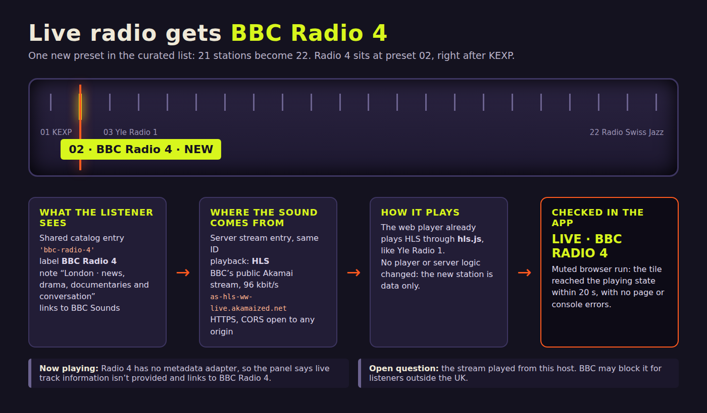
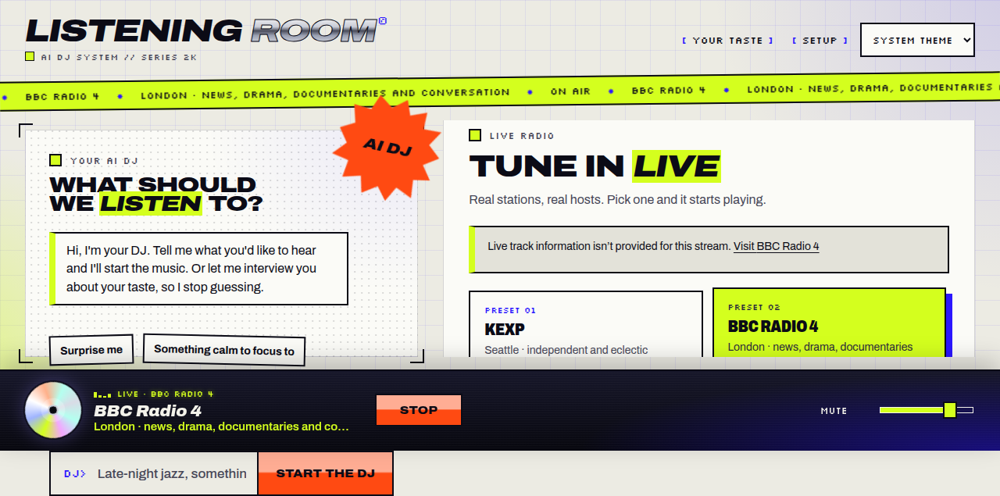

# Add BBC Radio 4 to the live radio list

**TL;DR:** Live radio now has 22 stations. The new one is BBC Radio 4 at preset 02, right after KEXP. It plays BBC's public HLS stream through the player the app already has, and it played in the app during the gate check.

Full summary

The request was "add bbc radio 4 if possible to list of radios" ([request](input/0001-task.md)). It was possible: BBC's own Akamai HLS stream for Radio 4 answers over HTTPS from this host and sends `Access-Control-Allow-Origin: *`, so the browser can load it with hls.js.

**What changed**

Each station is defined in two places that share one ID. This change adds `bbc-radio-4` to both:

- [`packages/contracts/src/index.ts`](../../../packages/contracts/src/index.ts), in `stationCatalog`: label "BBC Radio 4", note "London · news, drama, documentaries and conversation", and the BBC Sounds live page as the website.
- [`apps/server/src/stations.ts`](../../../apps/server/src/stations.ts), in `stationStreams`: `playbackKind: 'hls'`, the 96 kbit/s `bbc_radio_fourfm` stream on `as-hls-ww-live.akamaized.net`, with the BBC Sounds page recorded as `third_party` provenance.
- [`apps/server/test/stations.test.mjs`](../../../apps/server/test/stations.test.mjs): the expected station count goes from 21 to 22. The same test already checks that every station has a matching ID, description and HTTPS stream.
- [`README.md`](../../../README.md): the station count and list now include BBC Radio 4, and it's listed with the stations that have no metadata adapter.

No player, server or API logic changed. The web player already handles HLS (Yle Radio 1 uses it), so the new station is just data.

**Now playing:** Radio 4 has no metadata adapter. Its now-playing request returns `unsupported`, and the panel says live track information isn't provided, with a link to BBC Radio 4. The request didn't ask for track or programme info.

**Where to look:** the two one-line additions in `index.ts` and `stations.ts`. The stream URL is the only new network target.

**Open questions**

- The stream played from this host. BBC may block it for listeners outside the UK. Someone abroad should try it before relying on it.
- BBC has changed its live stream URLs before. If this one stops working, the fix is a new URL in `stations.ts`.

## Screenshots

From the gate's muted browser run, after clicking the BBC Radio 4 tile. The player bar says **LIVE · BBC RADIO 4** (shown only after the audio element's `playing` event), the tile is highlighted as preset 02, and the now-playing panel explains that the stream gives no track info.

## Phase reports

Work pass 1: implemented

As reported by the implementer:

Added BBC Radio 4 as an HLS station: label and note in `packages/contracts/src/index.ts`, and the stream in `apps/server/src/stations.ts`. The stream is BBC's public Akamai 96k Radio 4 HLS URL. It answers 200 over HTTPS from this host with `Access-Control-Allow-Origin *`, so hls.js can load it. The station count in the test is now 22. Typecheck and all 42 server tests passed. The implementer did not play it in the browser and noted that the stream may be UK-only for listeners elsewhere. The URL is listed as `third_party` provenance. No now-playing metadata was added, so the station shows as unsupported there.

Status of this evidence: the code these checks covered is the final code. The later README edit didn't touch code.

Gates pass 1: passed (risk: low)

As reported by the gates session. These checks ran on the final code diff:

- **Fast checks:** build-contracts, typecheck, tests-server (including the 22-station count) and tests-web-adapters all passed.
- **Smoke:** a muted browser run of the real app passed. The BBC Radio 4 tile was in Live radio, and clicking it reached "LIVE · BBC RADIO 4" within 20 seconds. The page and console showed no errors. Details: [gate check results](gate-check-results.md), [gate check plan](gate-checks.json).
- **Not run:** the build, full test suites and security checks. No dependencies or build configuration changed, the suites had already passed, and no security-sensitive code changed. The only new network target is a fixed HTTPS URL.
- **Review:** the gates session read the whole diff line by line and found no defects.
- **Fix:** the gates session updated the README (22 stations, BBC Radio 4 in the station list and in the list of stations without a metadata adapter). These are docs-only edits, so no check was rerun after them.

Still uncertain after gates: the stream may be blocked for listeners outside the UK, and Radio 4 shows no now-playing information.

No separate evaluation phase ran for this task. The intake lead decided a second reviewer would add little to a one-station change.

## Release notes

This summary and its images were written in the task folder only. The product code is exactly as the gates left it. The infographic is an HTML layout captured with headless Chromium, because native image generation wasn't available. Everything on it comes from the diff and the gate's browser run.
