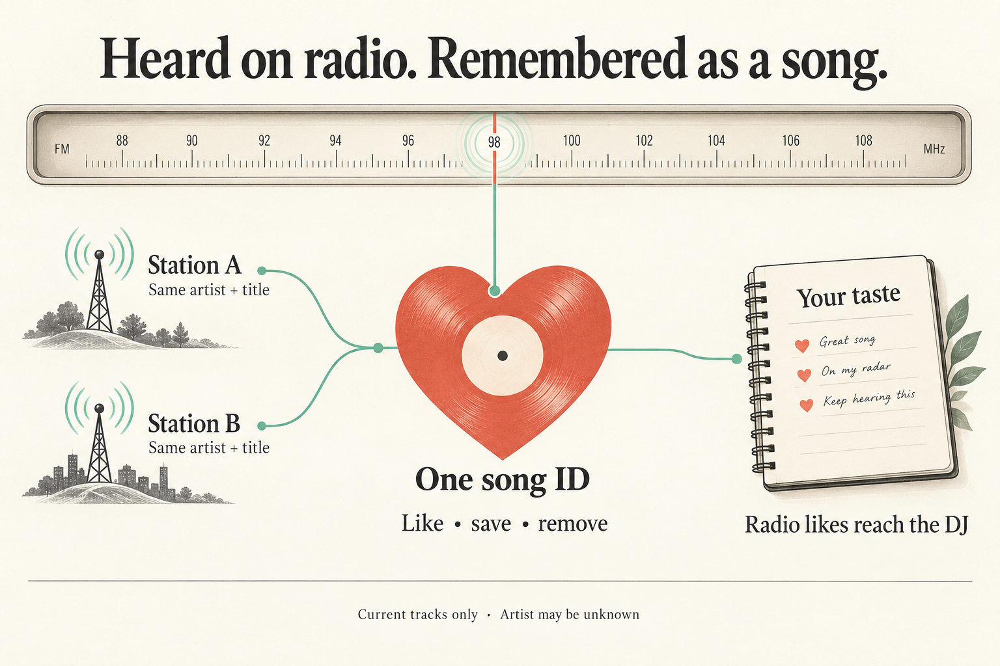
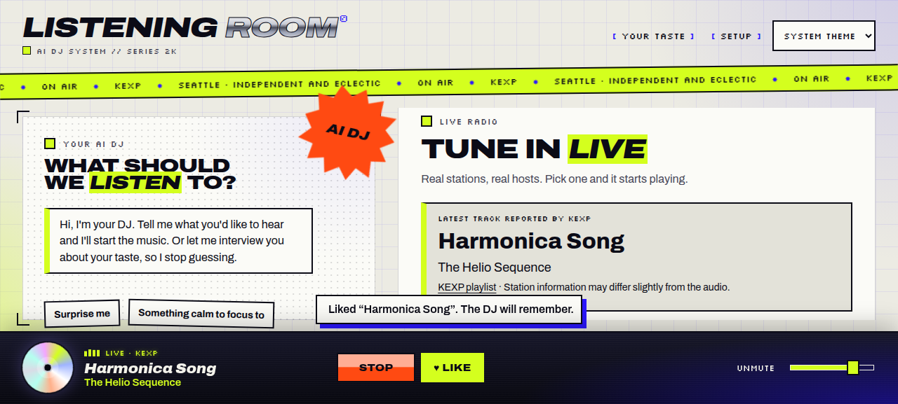

## TL;DR

Radio songs now have a Like button when a station reports a current track. Likes survive reloads, can be removed, and reach the DJ through the existing taste records.

How it works, verification, and where to review

This fulfills the [request](input/0001-task.md) to like radio songs when song information is present. The server attaches a `songId` only to current track metadata. The player uses that ID for the existing Like toggle, pending state, saved feedback, and confirmation messages. Programmes and unavailable, unsupported, or stale metadata do not gain a Like button. Radio does not gain “Not for me.”

Radio IDs hash the normalized artist and title: trimming, collapsing whitespace, and ignoring case. Matching metadata therefore shares one radio ID across stations. An artist may be unknown; that title-only identity differs from the identity with a named artist. This does not link radio songs to local or YouTube IDs or create playable library entries.

Feedback supplies the radio song's title and nullable artist, and the server checks that they match the ID. The existing revision and idempotency flow persists the reaction in `likes.csv` with source `radio`. Taste context and the Codex guidance explain radio likes to the DJ.

Start review with [the player state](../../../apps/web/src/main.tsx), [the Like button](../../../apps/web/src/player-bar.tsx), [contracts](../../../packages/contracts/src/index.ts), [API validation](../../../apps/server/src/index.ts), and [taste persistence](../../../apps/server/src/taste.ts). The [new tests](../../../apps/server/test/taste.test.mjs) cover normalization, persistence across restart, DJ context, removal, and rejection of missing or mismatched song metadata. The [README](../../../README.md) describes the API payload and CSV source.

The gates report passing builds, typecheck, the full server suite (45 tests), web adapter tests, security checks, and review ranking. A recorded browser walkthrough verified liking, persistence after reload, removal, and the absence of “Not for me.” Final API checks verified successful save/removal and 400 responses for invalid radio payloads. Phase history and the limits of that evidence appear below.

## Screenshots

Actual browser captures from the implementation walkthrough. The web code remained unchanged through the gates; the later fix affected server validation.

Liked radio song, with confirmation and the active heart:

The same song after removing the like:

## Player experience

The player offers a Like toggle for the current radio song and restores its saved reaction.

Player behavior

[main.tsx](../../../apps/web/src/main.tsx) adapts current metadata carrying a `songId` into the reaction flow. Requests send `radioSong` instead of a playable `media` item. The player reads pending and persisted reactions by that song ID, and displays the existing success and removal messages. [player-bar.tsx](../../../apps/web/src/player-bar.tsx) exposes Like independently of the local/YouTube-only “Not for me” control.

The muted KEXP walkthrough used “Harmonica Song” by The Helio Sequence. It removed an existing like, liked the song again, reloaded and restarted KEXP, confirmed the liked state persisted, then removed the like. The screenshots above show the successful toggle states. Playback was stopped afterward.

## Song identity, persistence, and DJ context

A radio song has a stable ID based on its artist and title, and its like enters the existing taste store.

Contracts and server behavior

[Contracts](../../../packages/contracts/src/index.ts) add `radioSongId`, `feedbackId`, and `RadioSong`, while playable media IDs remain local or YouTube IDs. The [now-playing route](../../../apps/server/src/index.ts) adds `radio:<sha256>` to current tracks. Feedback and taste queries accept radio IDs.

The feedback route rejects a radio reaction carrying `media`, a non-neutral radio reaction without `radioSong`, metadata that hashes to another ID, and `radioSong` attached to a non-radio ID. Removing a radio like can omit song metadata. The [taste repository](../../../apps/server/src/taste.ts) reads and writes CSV rows with source `radio`, retains title and artist, and includes radio song metadata in request fingerprints. Existing taste context carries these rows; [Codex guidance](../../../apps/server/src/codex.ts) explains their meaning for taste synthesis and track selection.

Identity depends on the station's reported spelling and artist availability. Case and spacing differences are normalized; other differences can produce separate IDs. No recording matching service is added.

## Phase reports and release evidence

The gates accepted the change for internal human testing. The following retains the supplied phase history and distinguishes final checks from earlier evidence.

Work pass 1 — implemented

No work report was recorded. The delivered diff adds the player toggle, radio feedback identity and contracts, API handling, CSV persistence, DJ guidance, tests, and README documentation described above. The browser evidence supplies the observed user journey; no additional work-phase checks are inferred from the phase status.

Evaluation — not enabled

A separate result-quality evaluation was not enabled for this run. There is no evaluation contribution to report.

Gates pass 1 — passed, with fixes and verification limits

The gates session classified this as high risk because it widens shared contracts, accepts external metadata, and persists it to taste CSV files.

The gates report states that the following passed on final code `e300089`: contracts build, typecheck, all 45 server tests, web adapter tests, full build, security scan, and review ranking. Fresh-server API checks with an empty data directory confirmed:

- Mismatched radio song metadata returns 400.
- A radio like without `radioSong` returns 400.
- A correct radio like returns 200 and is saved.
- Removing a like without `radioSong` returns 200.
- Sending `radioSong` with a YouTube ID returns 400.

The session fixed malformed radio feedback returning 500; it now returns 400 (`e300089`). It also documented song IDs, request metadata, mismatch responses, and CSV source `radio` in the README (`0fab9dd`).

The saved [check results](gate-check-results.md) document branch-scoped security checks against merge base `46d0adec6357`, covering nine files. Gitleaks, DevSkim, and Checkov completed with no open findings. Six DevSkim findings were already ignored with recorded reasons concerning intentional loopback restrictions and fixed-delay timer callbacks. Bandit, Gosec, PMD, Psalm, Trivy, and Zizmor were skipped because no applicable files were in scope; they did not provide coverage.

The same saved record identifies review ranking as running at implementation commit `9228b37`, before the README and validation fixes. It prioritized taste persistence, API handling, web state, and contracts, and flagged the length of `main.tsx`. This was review prioritization, not an independent approval. Although the accumulated gates report lists review ranking and security among final-code checks, the saved detailed output does not establish that either was repeated after the fixes.

No separate smoke run was performed during gates. The earlier KEXP walkthrough covered Like visibility, saving, reload persistence, removal, and absence of “Not for me.” It predates the server-only validation fix; web code was unchanged, and final API checks exercised the server change. No separate `full_tests` step ran because the fast checks already included the whole suite. See the [gate selections](gate-checks.json).

Remaining uncertainty: route validation has no automated regression test because the project has no route test harness. Manual API checks cover the reported cases. This release-summary step inspected the diff and existing evidence; it did not repeat product checks or alter product code.

