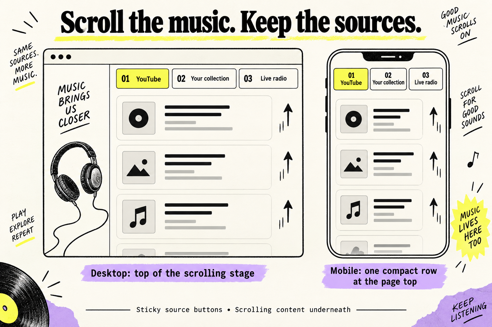
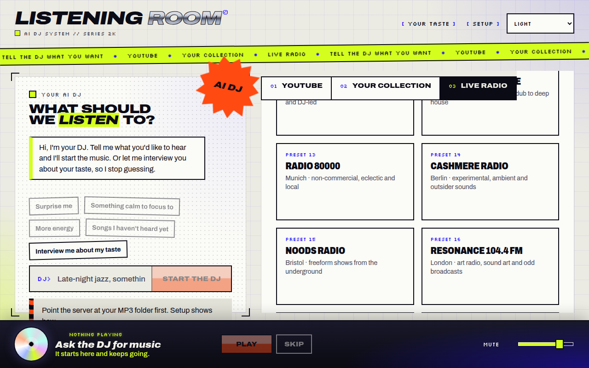
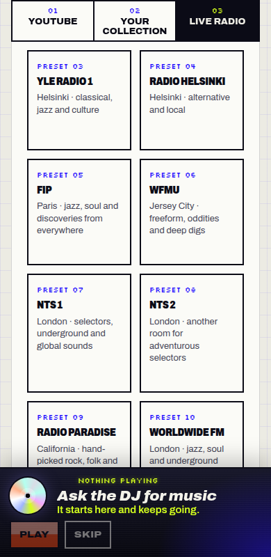
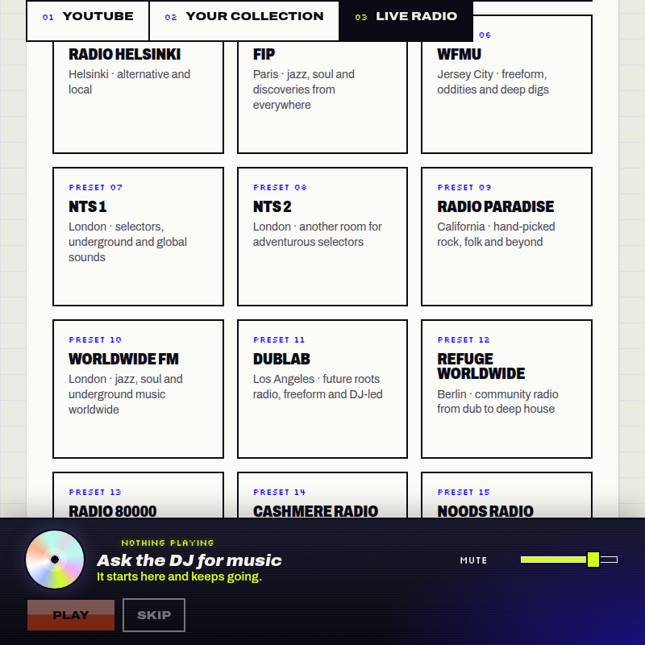

The 01 YouTube, 02 Your collection and 03 Live radio buttons now stay visible while you scroll through the sources. On phones, they share one compact row to leave more room for content.

What changed, how it works and verification

The [request](input/0001-task.md) and its [attached screenshot](input/attachments/image.png) identify the three source buttons. Previously, scrolling the source lists also moved these buttons out of view.

In [style.css](../../../apps/web/src/style.css), `.stage .mode-switch` now uses `position: sticky`, `top: 0` and `z-index: 5`. Above 960px, it sticks to the top of the independently scrolling stage; at narrower widths, it sticks to the page viewport once reached. A shadow using the theme's `--paper` color covers the gap immediately above the buttons. At 640px and below, the buttons use three equal columns, with each number above its label, instead of a vertical stack.

Review the sticky rule near `.stage` and the button layout inside the 640px media query. The browser evidence shows the requested buttons remain visible and unobstructed. On desktop, cards remain visible beside the button row and in a thin strip above its edge; the row does not form a full-width background band. Gates accepted this as an optional visual refinement for human review.

**Work pass 1 — implemented.** The implementer added the sticky behavior and compact phone row, then verified the rebuilt app in the browser: desktop at 1280px after scrolling the stage 600px, and mobile at 390px after scrolling the page 1500px. On mobile the buttons were 2px below the viewport top. This pass did not run lint or tests, or check light theme or the 640–960px range.

**Evaluation — skipped.** A separate result-quality evaluation was not enabled for this small layout change; no evaluation contribution was produced.

**Gates pass 1 — passed.** Gates rated the CSS-only change low risk. `typecheck`, `build` and `tests-web-adapters` passed. Browser smoke checks after scrolling 1200px passed at 800×800 in system and light themes, and at 1280×800 in light theme. Nothing covered the buttons. These checks close the work pass's light-theme and intermediate-width gaps. The [saved smoke report](gate-check-results.md) records the browser observations, including the visible content beside and above the desktop row.

Gates reviewed the whole diff and found no problems; no fixes were made. The review confirmed the use of the theme variable and consistent mobile border rules. Server tests were omitted because no server code changed. The project has no lint or formatting scripts. Documentation and security work were omitted because this is a styling-only change with no security-related behavior.

**Evidence applies to the delivered CSS.** An earlier browser attempt still showed the old behavior before the rebuilt app was reloaded; it is superseded by the subsequent rebuilt-app captures and gates checks above. No product edits or new checks were made during release preparation. The change is ready for internal human testing, with the desktop background treatment left for optional visual adjustment.

### Screenshots

Desktop, light theme, 1280×800 after scrolling the stage 1200px. The source row remains above the radio cards; the visible content at its sides and upper edge is the visual caveat noted by gates.

Phone, 390×800 after scrolling the page 1500px. All three buttons stay in one row at the top, above the list and clear of the docked player.

Tablet, light theme, 800×800 after scrolling the page 1200px. The source buttons remain at the viewport top.

