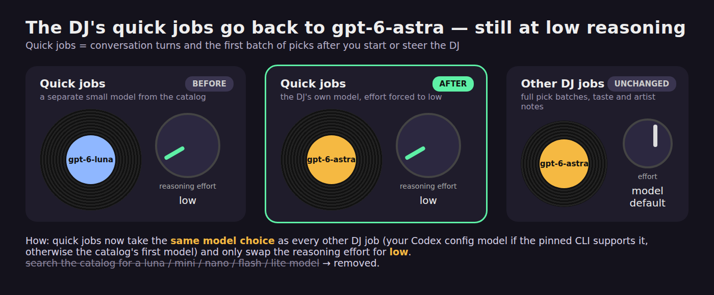

# Put the DJ's quick jobs back on gpt-6-astra at low reasoning effort

**TL;DR:** Conversation turns and the first batch of picks now use the DJ's own model (`gpt-6-astra` in the pinned catalog) at low reasoning effort. They no longer switch to the catalog's small model, `gpt-6-luna`.

Full summary

## What changed and why

The request was: "bump the dj model back to astra, but keep at low reasoning".

Commit d927caa made quick DJ jobs (conversation turns and the first batch of picks after you start or steer the DJ) search the Codex catalog for a small model. It looked for slugs containing luna, mini, nano, flash or lite, picked `gpt-6-luna`, and ran it at low effort. Before that commit, these jobs used the catalog's preferred model, `gpt-6-astra`. This change puts them back on that model and keeps low effort.

## How it works

`quickModelOverrides` in [apps/server/src/codex.ts](../../../apps/server/src/codex.ts) is now one line. It calls `modelOverrides`, the same function every other DJ job uses, removes its reasoning-effort setting and adds `model_reasoning_effort="low"`. The model choice is the same as for other jobs:

- If your Codex config names a model the pinned CLI supports, no `model=` override is sent, so Codex uses your model, at low effort.
- Otherwise the first listed model in the pinned CLI's catalog is used, at low effort.

The small-model search is gone. Full pick batches, taste notes and artist notes are unchanged: they still use the same model at its default effort.

**One behavior change to check:** if the chosen model's catalog entry lists only "high" effort, quick jobs now ask for "low" anyway. Before, the small-model path fell back to that model's default effort. The gates accepted this because the user asked for low effort, and the old no-small-model fallback already forced low in the same way.

## Where to look

- [apps/server/src/codex.ts](../../../apps/server/src/codex.ts): `quickModelOverrides`.
- [apps/server/test/codex-startup.test.mjs](../../../apps/server/test/codex-startup.test.mjs): the test `quick jobs use the model at low effort`. With a newer configured model, it expects `gpt-6-astra` at low effort. A configured model the CLI supports (`gpt-6-luna`) gets only the low-effort override. The high-only case now expects low effort.
- [README.md](../../../README.md): the paragraph on music job models now says "the same model at low effort" instead of naming `gpt-6-luna`.

## How it was verified

These checks ran on the final code. Nothing changed after them.

- Type check across all workspaces passed.
- The full server test suite passed (45 tests).
- The project has no lint or format script, so no lint ran.
- No live Codex call was made because it costs money. The unit test checks the exact config values passed to Codex. How fast astra actually answers at low effort is not confirmed.

There are no screenshots because nothing changes on screen.

## Phase reports

### Work, pass 1 (implemented)

- `quickModelOverrides` now takes `modelOverrides(...)` and replaces its effort with "low". The small-model search is removed.
- The quick-job test expects `gpt-6-astra` at low effort. A configured model the CLI supports gets only the low effort. The high-only case expects low effort.
- README now says "the same model at low effort" instead of naming `gpt-6-luna`.
- Checks: `npm run typecheck` passed in apps/server. `npm test` in apps/server built and ran 45 tests, all passing. No lint ran because no lint script exists.

### Evaluation

Not enabled for this run. The change is small and the unit tests and code settle it.

### Gates, pass 1 (passed, no fixes)

- Risk: low. One small function, its unit test and one README sentence.
- Ran on the final working tree: `taiga runner typecheck` (all workspaces) passed. `taiga runner tests-server` (the full server suite) passed. No lint ran because none is configured.
- Left out on purpose: build (no dependency or build changes), smoke test (it would call the paid hosted model), tests outside the server (the web app does not use this function), security review (no sensitive paths changed), docs (the README was already updated).
- Code review: the whole diff was read line by line. Quick jobs use the preferred or configured model with `model_reasoning_effort="low"`, which matches the request. The high-only-effort behavior change described above was reviewed and accepted.
- The gates fixed nothing, so the work pass's test results also still apply to the final code.

