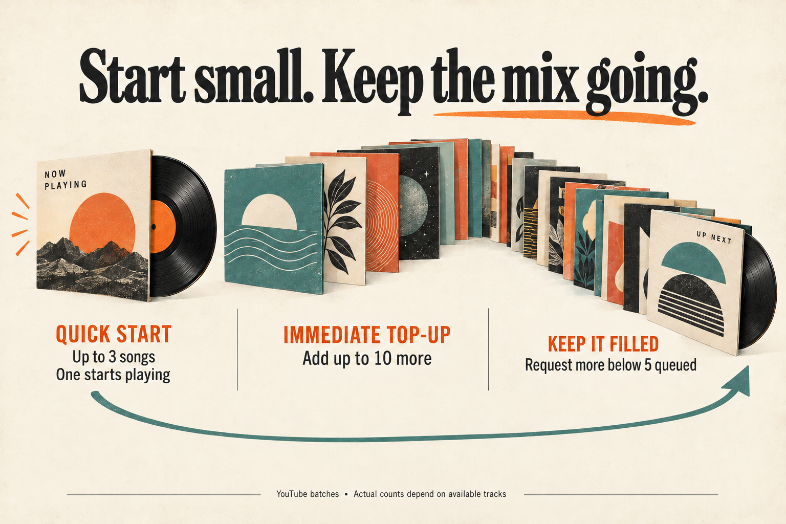
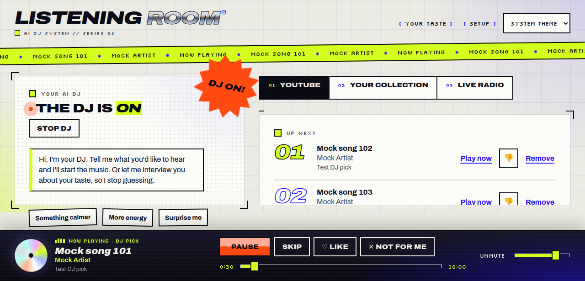

## TL;DR

The DJ now follows its quick first batch with an immediate top-up, and requests more music when Up next falls below five songs. Normal YouTube batches keep up to ten playable tracks instead of five, giving listeners a longer list while preserving the quick start.

What changed, why, and how it was checked

The [request](input/0001-task.md) reported only two songs after asking for a longer list. The quick batch kept three tracks, one began playing, and refill waited until fewer than two remained.

The quick batch still asks for five candidates and keeps up to three. After a successful quick batch, the web app releases the pending request and starts a normal batch for the same session and mode. Normal YouTube batches now ask for fourteen candidates and keep up to ten playable tracks. The model reply schema accepts up to sixteen picks so a fourteen-pick response is valid. Queue advancement and removal now use a refill threshold of five.

This is a general increase in queue length. It does not interpret “longer” as a configurable song count or enforce a ten-song queue cap. Tracks are appended, and actual counts depend on available, fresh results. The existing YouTube lookup workers and filtering remain in place; larger batches mean more potential lookups.

Start review at [the queue request and refill logic](../../../apps/web/src/main.tsx), then [YouTube batch selection](../../../apps/server/src/dj.ts) and [the model reply schema](../../../apps/server/src/codex.ts). [README](../../../README.md) describes the new behavior.

The gates passed typecheck, server and web tests, contracts build, application build, and a muted browser smoke test using music-mock. The mock queue grew from two to twelve with two recommendation requests and no observed refill loop over roughly thirty seconds. Real Codex generation and YouTube discovery with the larger batch remain unverified. Phase evidence and its limits are recorded below.

## Screenshot

Captured by the gates browser against music-mock. Only the first two queue rows fit in this view; the browser report counted twelve queued songs after the top-up. The screenshot alone does not demonstrate that count. Playback was muted, then the browser navigated to about:blank.

## Queue behavior

The first batch starts music quickly; a second request fills out Up next, and later refills begin below five queued songs.

Frontend behavior

In [main.tsx](../../../apps/web/src/main.tsx), a successful quick request triggers one normal request after cleanup, provided the request was not aborted and its session and mode still match. The existing request guard prevents concurrent recommendation requests. Both advancing to the next track and checking the queue after removal now use the same five-song threshold.

The browser smoke test exercised the initial top-up with a mock backend. No automated test was added for this React flow; the project has no React test harness. The later threshold crossing was not separately demonstrated in the supplied browser report.

## YouTube batch size

Normal batches can return twice as many playable songs, with room for candidates that discovery rejects.

Server behavior and documentation

In [dj.ts](../../../apps/server/src/dj.ts), normal batches request fourteen candidate tracks instead of eight and retain up to ten instead of five. Quick batches remain five candidates and up to three retained tracks. Five existing lookup workers resolve candidates; recent-song exclusion, duplicate filtering and stream verification remain in effect.

In [codex.ts](../../../apps/server/src/codex.ts), the pickTracks schema limit rises from twelve to sixteen. The gates caught this mismatch before delivery: a complete fourteen-pick response would otherwise have failed validation. The README and batch comment now describe the final behavior.

## Phase reports

Work pass 1 — implemented

The work pass added the immediate top-up, increased normal YouTube batches to fourteen candidates and up to ten retained tracks, and raised the refill threshold from two to five. It described the outcome as “about 10 songs”; the final implementation appends batches rather than targeting an exact total.

Typecheck, 45 server tests and 11 web tests passed at this point. The work pass did not run the app or use a browser and added no automated top-up tests. These results preceded the gates' schema correction, comment edit and README update; the final-code checks below supersede the earlier typecheck and server-test evidence.

Gates pass 1 — passed, medium risk

The gates rated the change medium risk because it changes queue refill behavior and increases potential YouTube lookups.

Checks and freshness:

- Typecheck and all 45 server tests passed after the gates' last edit.
- All 11 web adapter tests passed in the fast run; nothing they cover changed afterward. They were not repeated after the final edits.
- Contracts build and application build passed.
- The muted music-mock browser smoke test observed Up next grow from two to twelve songs, with one song playing. Two recommendation requests were made, with no refill loop observed over roughly thirty seconds. The later comment and schema edits do not affect this mock result; the mock does not generate real model replies.
- Full tests were not run again as a separate gate because the fast run already covered every suite.
- Security scanning was skipped because the change touches no input handling, shell, file access, secrets or dependencies.

Gates corrections: raised the pickTracks reply schema limit from twelve to sixteen, clarified the batch-size comment, and updated README with the new sizes and top-up behavior.

Code review scope: the saved branch review command returned “No changed files to review” because HEAD still matched the run's starting commit and the product edits were uncommitted. That command did not review the working-tree change. The gates did inspect and correct the schema mismatch described above; no broader automated code review is established by that command's passing status.

Remaining limits: neither the fourteen-song request nor the top-up was exercised against the real Codex DJ. No automated React test covers the top-up. Nothing was committed at the time of the gates handoff. The [saved gate results](gate-check-results.md) include the build, smoke and branch-review outputs, and [gate choices](gate-checks.json) explain selected and skipped checks. The browser output also lists failed intermediate actions; its final report records the successful smoke observations above.

Separate result-quality evaluation was disabled; no evaluation contribution was produced. The mock evidence supports the requested longer queue for internal human testing, with real DJ behavior still to confirm.
