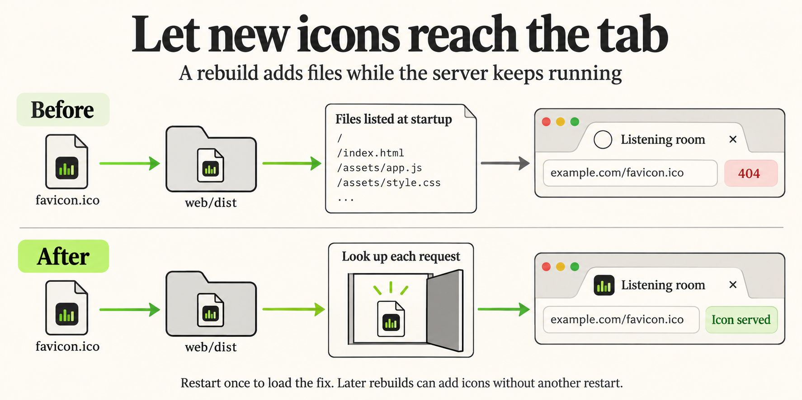
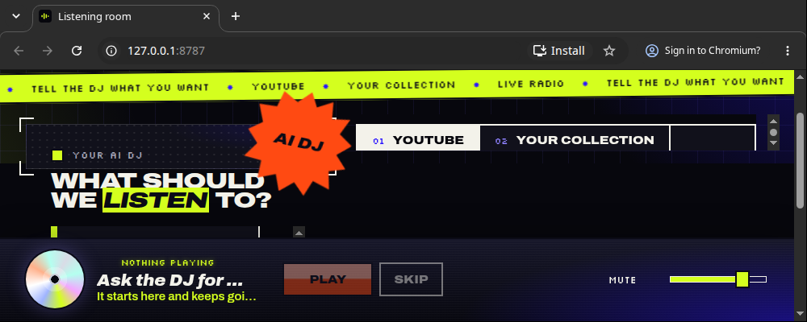
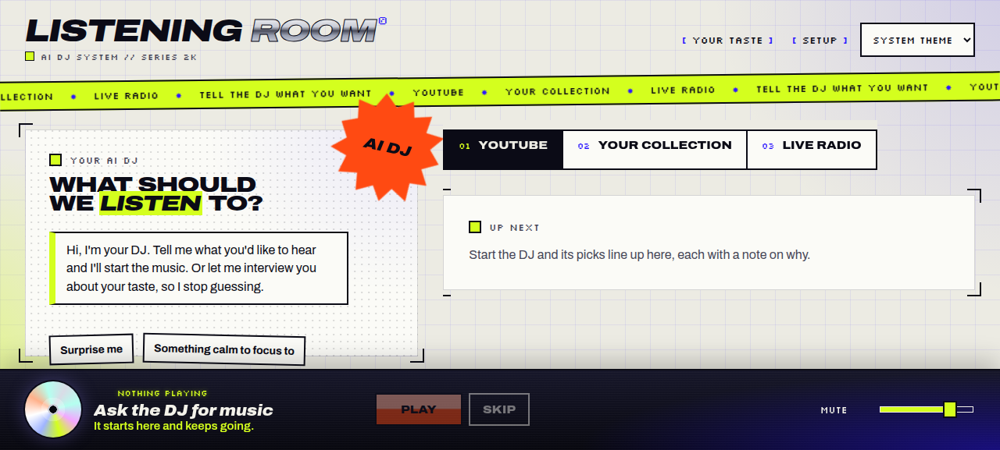

**TL;DR:** Fix the missing Listening room favicon when a rebuild adds icons to an already running production server. Static files are now looked up on each request, so later rebuilds can add files without restarting the server.

What changed, why it works, and where to review

The [request](input/0001-task.md) reports that the browser favicon is still missing. The icon assets and HTML links already worked. The production server used `@fastify/static` with `wildcard: false`, which registered only files present at startup. A later rebuild could update `index.html` to reference icons while requests for those newly added files still returned 404.

[Static serving in index.ts](../../../apps/server/src/index.ts) now uses the plugin's default wildcard lookup within `apps/web/dist`. Files added after startup become available on subsequent requests. Existing API routes retain priority; unknown pages return plain-text 404 responses and unknown API paths return the JSON `not_found` error. The server continues listening on `127.0.0.1`.

[The regression test](../../../apps/server/test/static.test.mjs) starts the built server, adds a file to the web build directory, and asserts that it is served. It also checks the favicon content type and missing-file and API responses. The worker confirmed that this test fails on the old code and passes with the fix.

Independent evaluation confirmed the favicon in a real Chromium tab on `npm start` at port 8787, including the case where icons were restored after startup. Final gates passed typecheck, build and all 46 server tests. The accumulated reports below distinguish earlier checks from final evidence.

**For internal testing:** restart an existing server once to load this server change. Subsequent rebuilds can add icons without another restart. The web build directory must exist when the server starts, as before.

### Screenshots

The evaluator's headed Chromium capture shows the equalizer favicon beside “Listening room” at `127.0.0.1:8787`. This is the actual tab, separate from the conceptual illustration above.

Runner browser capture and its limits

The runner's own browser evidence shows the production page. That tool captures page content without the tab strip; it separately verified that both icon links returned 200 and decoded successfully. The headed Chromium capture above supplies the visible tab evidence.

### Accumulated phase reports

All three phases reviewed the same product change. No product edits followed evaluation or gates. Release preparation added only this summary and its assets; it did not repeat application checks.

Work pass 1 — implemented

**Delivered:** removed `wildcard: false`, added the explanatory comment and the static-serving regression test. The worker reproduced the old failure by starting the server without the two icon files and restoring them afterward: `/` returned 200 while both icons returned 404. With the fix, a Chromium tab showed the icon in that scenario. The earlier favicon run's build timing was consistent with this cause; the user's original running process was not directly inspected.

**Browser checks:** headed Chromium and Firefox under Xvfb showed the icon on production port 8787 through both localhost and 127.0.0.1, on Vite port 5173, and in a Chromium profile that had previously seen the app without icons. Unknown pages and API paths retained their expected responses; `/../package.json` returned 403.

**Checks:** typecheck and build passed; web adapter tests passed 11/11. Server tests initially passed 45/46. The `codex-startup.test.mjs:94` “npm PATH” case resolved the Codex binary to an empty string and failed without this change too; the worker recorded a finding. This early failure was superseded by the gates run's 46/46 pass, without a product code change.

**Delivery limits at handoff:** two `taiga git` attempts failed with “workspace routing discovery timed out,” reported as Factory bug #270, leaving the product changes uncommitted. Runner calls were interrupted by Factory restarts, so the worker ran checks directly with npm. The worker's original `/tmp/favtest/fixed-big.png` screenshot was unavailable during release preparation; the retained evaluator capture supplies tab evidence.

Evaluation pass 1 — good

**Judgment:** the change addresses the reproduced cause with the simplest correct fix and a regression test. The only intended visible change is the tab icon.

**Independent evidence:** build passed. The evaluator started production with both icons absent, restored them without restarting, and received 200 with `image/vnd.microsoft.icon` for `/favicon.ico`, 200 with `image/svg+xml` for `/icon.svg`, and 200 for `/`. Unknown page and API paths retained their plain-text and JSON 404 responses. A fresh headed Chromium profile showed the equalizer favicon in the tab; that screenshot is retained above.

The runner browser independently verified both icon links and image decoding (48×48 ICO and 150×150 SVG). Its screenshot could not capture browser chrome. Initial runner browser actions encountered a missing browser lock before the successful verification.

**Limits:** evaluation did not repeat the worker's Firefox or Vite checks. The production-only change does not alter the dev server. Evaluation stopped its own server and made no file changes. The one-time server restart and uncommitted handoff remained applicable.

Gates pass 1 — passed

**Final-code checks:** typecheck, build and the full server suite passed, including the new regression test: 46/46. The earlier Codex startup failure did not recur. The gates session classified the change as high risk because static serving now resolves request URLs against disk on each request.

**Review:** the [saved ranking report](gate-check-results.md) rated the two files at 20.5 and 17.8 out of 100, with no code smells. Code review confirmed fixed API routes retain priority, both kinds of 404 remain correct, static lookup stays within `web/dist`, the listener remains local, and the test cleans up its files. The reported traversal probe returned 403. No repairs were required.

**Scope and omissions:** no separate security scan was run; path safety was covered by review and the traversal probe. No dependency or sign-in changes were involved. Web adapter tests were not repeated after the worker's 11/11 pass. Smoke testing reused evaluation's real-tab evidence. No broader full-test run or documentation check was added; the [gate selections](gate-checks.json) record those choices, including reuse of the fast build and server checks.

The code remained unchanged after these checks. At the gates handoff it was still uncommitted because of the earlier Git helper failure. A running server still needs one restart to load the fix. The Factory handles committing and opening the pull request after this summary.

