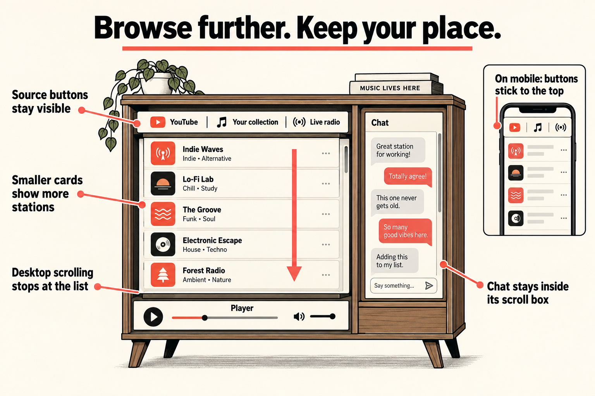
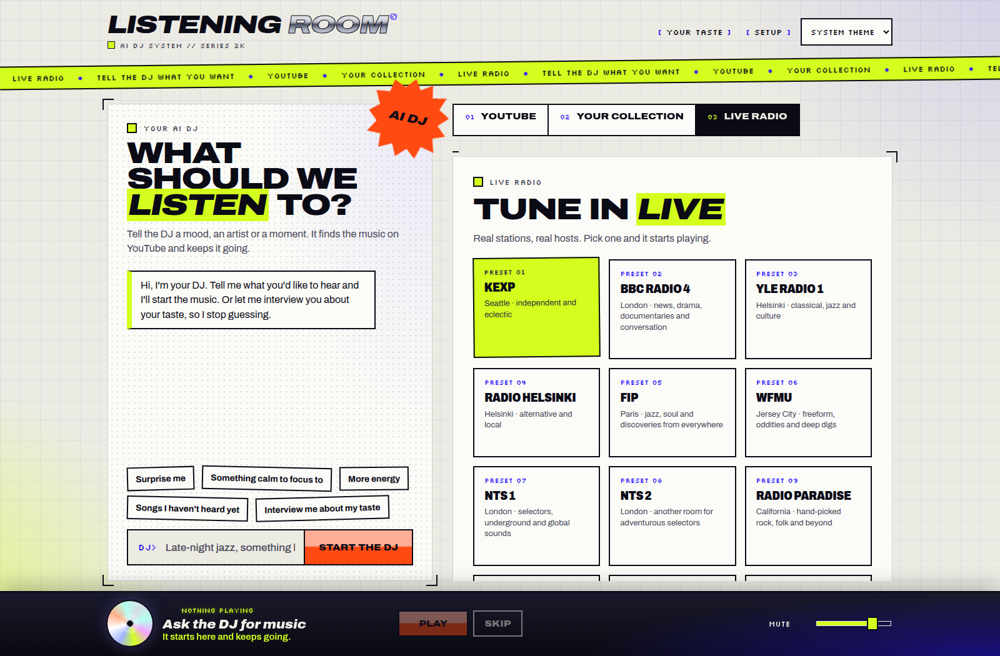
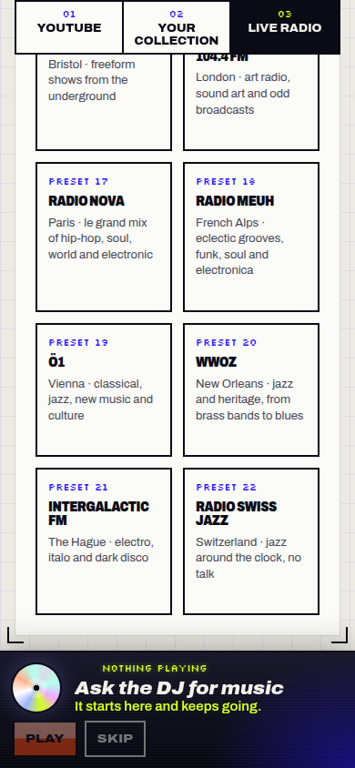

Radio browsing now keeps the source buttons visible and stops desktop scrolling at the end of the list, without exposing the empty space above the player. Station cards are smaller, and long chats no longer stretch the page.

*Conceptual illustration of the layout behavior; the screenshots below show the actual interface.*

How the change works and where to review it

The [request](input/0001-task.md) and [attached screenshots](input/0002-attachments.md) describe the page moving beyond the radio list, disappearing source buttons and a preference for smaller cards.

In [main.tsx](../../../apps/web/src/main.tsx), a new `.stage-body` wraps the radio, queue, collection and artist panels beneath the source buttons. In [style.css](../../../apps/web/src/style.css), `.stage` becomes a flex column. Above 960px, only `.stage-body` scrolls; `overscroll-behavior: contain` prevents scrolling from passing to the page at its boundary. The source buttons stay above that scroll area. On narrower screens, the buttons stick to the top of the window while the page scrolls. The previous sticky buttons sat in a grid row that constrained their movement.

The other overflow cause was the chat's absolutely positioned, visually hidden “DJ:” and “You:” labels. Adding `position: relative` to `.chat-log` keeps those labels inside its scroll box. Work reproduced a document height of 8059px in a 1050px window with 30 simulated messages before this fix; afterwards it stayed at 1050px.

Station cards use a smaller minimum column width (200px → 176px), lower minimum height (168px → 136px; narrow screens 144px → 120px), tighter padding and gaps, and slightly smaller text. Evaluation found the resulting three desktop columns and two mobile columns readable and tidy.

The final product change is commit `6919967`, compared with the run's starting point `649d5f3181cb`. No product code changed during the second Work pass, either Evaluation pass, Gates or this release-summary step. The phase reports below distinguish the corrected browser-tool finding from evidence that still applies to this code.

### Screenshots

Desktop, 1600×1050: compact station cards and source buttons above the scrolling panel.

Mobile, 390×844, at the end of the list: source buttons remain at the top, and the final stations sit above the player.

These are the browser's saved Evaluation pass 1 captures (`capture-cee145dd…` and `capture-c92f958e…`), copied into this task. They show the final product code; the desktop wheel-input conclusion from that pass was later corrected. All three images were opened and checked for readability during release preparation. The infographic was generated with the built-in image generation tool; its [generation brief](implementation_summary/image-generation.md) is saved alongside it.

### Work reports

Work delivered the layout fix and compact cards in pass 1. Pass 2 confirmed desktop wheel scrolling and made no code change.

Work pass 1 — implementation and initial verification

Committed `6919967`, changing only `apps/web/src/main.tsx` and `apps/web/src/style.css`. Work identified the escaped hidden chat labels and the grid-constrained sticky buttons, added the panel wrapper and scroll containment, and reduced card sizes as described above.

Headless Chrome checks with 30 injected chat messages found:

- At 1600×1050, scrolling to the end left `scrollY` at 0 and source buttons visible.
- At 390×844 and 820×1000, the buttons stuck at window top 0 and the last cards ended above the player.
- Typecheck passed, all 11 web adapter tests passed, and the build succeeded.

These initial scroll checks used scripted scrolling, so they did not establish wheel-input behavior. Firefox and a real long DJ conversation were not checked. The code and other evidence remain applicable because no later pass changed the product.

Work pass 2 — real wheel input and the tool issue

Work made no code change. A capturing wheel listener showed that agent-browser's wheel command dispatched at `(0,0)`, targeting the document, despite moving the pointer over the list. Work reported Factory bug #272.

Using CDP `Input.dispatchMouseEvent` with `type: mouseWheel` at coordinates over the panel, ten 400px steps reached the list boundary:

| Viewport | Panel | Final scrollTop / maximum | Page scrollY | Buttons top |
| --- | --- | --- | --- | --- |
| 1600×1050 | Live radio | 892 / 892 | 0 | 166px |
| 1600×1050 | Collection with a 1500px test block | 1186 / 1186 | 0 | 166px |
| 1100×800 | Live radio | 1448 / 1448 | 0 | 162px |
| 1100×800 | Collection with test padding | 1456 / 1456 | 0 | 162px |

The page height stayed equal to the viewport. Earlier coordinate-based wheel checks over cards, the heading and the right edge also moved the list. At 1100×800, the last two stations were fully visible above the player.

YouTube had insufficient content to scroll, and the attempted test padding did not attach to that panel; it shares `.stage-body` with collection but did not receive a successful overflow test. Mobile behavior, card sizes and the chat fix were unchanged.

### Evaluation reports

The final judgment was **good**: the change meets all three requests. The first pass's desktop scrolling failure was a tool artifact and was explicitly withdrawn.

Evaluation pass 1 — historical send-back, later corrected

Evaluation confirmed that mobile navigation stayed visible, the last mobile cards cleared the player, desktop page overflow was gone, and smaller cards were readable at three desktop columns and two mobile columns.

It initially reported that wheel input could not reach beyond the first nine stations on desktop. Agent-browser wheel commands over several intended list positions left `.stage-body.scrollTop` at 0, while an injected control at the top-left scrolled. Two runner browser attempts saw the same failure. Evaluation requested real wheel verification at 1600×1050 and about 1100×800.

Pass 2 established that the tool actually sent wheel events to the top-left control rather than the intended list coordinates. This pass's wheel-failure conclusion is superseded; its visual and mobile observations remain relevant to the unchanged final code.

Evaluation pass 2 — final acceptance with independent wheel verification

Evaluation acknowledged the mistaken send-back and independently used Playwright Chromium's pointer-positioned `mouse.wheel` against a fresh server from `6919967`:

| Viewport | Wheel position | ScrollTop after successive 400px steps | Page scrollY | Buttons top |
| --- | --- | --- | --- | --- |
| 1600×1050 | 1075,700 | 400, 800, 873 (end) | 0 | 166px |
| 1100×800 | 748,480 | 400, 800, 1200, 1448 (end) | 0 | 162px |

Page heights stayed at 1050px and 800px respectively. This confirmed Work's corrected findings. Mobile evidence came from pass 1, where the last card ended about 39px above the player. Evaluation compared the user's original screenshot with desktop, mobile and end-of-list captures: the smaller cards preserved their label, name and note hierarchy, with no clutter or cropped text. At 1100×800, stations 21 and 22 were fully visible above the player.

No fixes were made. Firefox was unavailable because its Playwright binary was missing. A real long conversation and physical trackpad input remained untested. The saved runner web service failed to start because a temporary preview folder was missing; evaluation used a separate fresh server and stopped it afterwards.

### Gates and readiness

Gates passed for internal human testing. The review found no additional changes necessary.

Gates pass 1 — checks, code review and remaining limits

Gates reported successful typecheck across workspaces, web adapter tests and production build on the final code. The repository has no lint or formatting scripts, so neither check ran. Gates read the full diff line by line, confirmed that the flex layout and button alignment were consistent across viewport sizes, checked that other `.stage` selectors did not depend on the old grid, and found no debugging leftovers or unrelated changes.

Server tests were omitted because only the web UI changed. No security scan ran: the change adds no dependencies and touches no security-sensitive path. Documentation checks were omitted because no documented behavior changed. Browser smoke testing was not repeated after Evaluation pass 2 because the code was unchanged.

The [saved gate choices](gate-checks.json) record these omissions and reuse of earlier checks. The [automatic gate command result](gate-check-results.md) says it ran no commands because none were selected; the successful checks above are the Gates phase's reported fast checks, not additional executions by that automatic step.

Remaining uncertainty: Firefox, a real long DJ conversation, physical trackpad input, and a populated YouTube panel's overflow behavior. Chat containment used simulated messages; collection overflow used test padding. Release preparation reviewed the diff and existing evidence and changed only this task folder; it did not repeat application checks.

