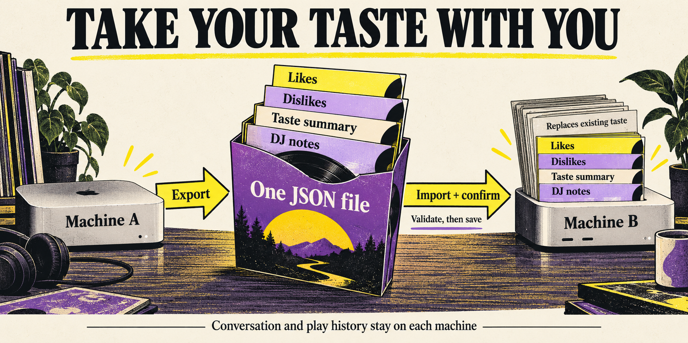
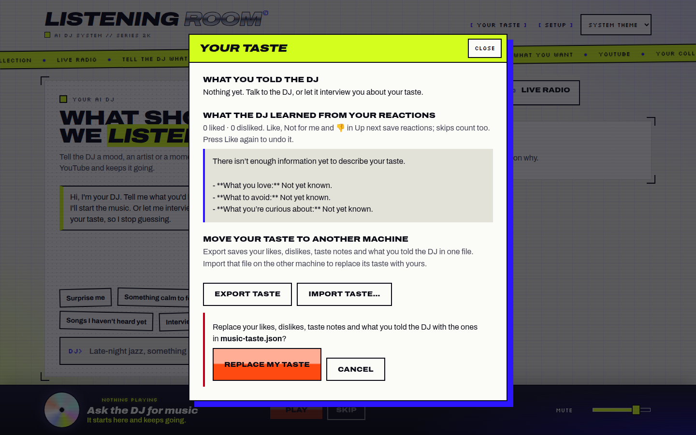
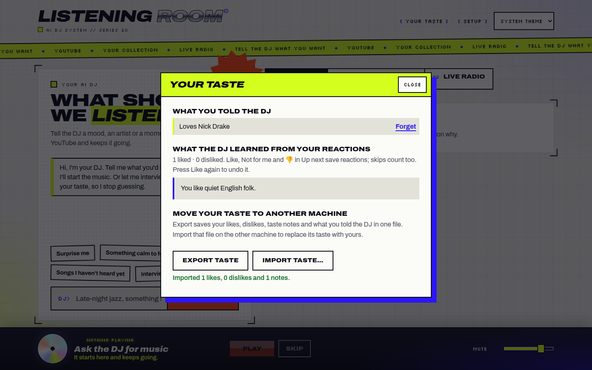

**TL;DR:** Export the taste your DJ has learned as one JSON file, then import it on another machine from **Your taste**. Import replaces that machine’s likes, dislikes, taste summary and DJ notes after confirmation.

What changed, verification and review guide

The [request](input/0001-task.md) is to take learned taste to another machine “as is.” Export includes `likes.csv`, `dislikes.csv`, `musical_taste.md` and the DJ’s notes. Import replaces rather than merges them. Conversation and play history stay on each machine.

`GET /api/v1/taste/export` downloads `music-taste-<date>.json`. `POST /api/v1/taste/import` accepts the versioned JSON format with a 12 MB request limit. It validates the schema, CSV rows, conflicting reactions and summary front matter before writing. Taste files use the repository’s existing serialization, lock, external-change detection, journal and manifest. Destination revisions keep increasing; the summary body is retained with rewritten revision metadata. A summary current at export stays current; a stale summary remains pending and synthesis is scheduled.

Start review with [the endpoints](../../../apps/server/src/index.ts), [taste replacement](../../../apps/server/src/taste.ts), [the shared schema](../../../packages/contracts/src/index.ts), and [the dialog](../../../apps/web/src/dialogs.tsx). [The README](../../../README.md) documents the transfer and API. The accumulated phase reports below describe verification and its limits. [CI failure accounting](../../test-failures/0011-export-and-import-taste-definitions.md) records the available GitHub evidence: no runs or checks were returned at initial release; this does not establish a CI pass.

**Known limit for internal testing:** saving the DJ notes happens after the journaled taste commit and is not part of that transaction. A notes write failure can leave the taste replaced with the old notes retained; retrying the import can complete it. The UI’s “Nothing was imported” error can therefore be inaccurate for this storage failure. Invalid-file rejection occurs before writes and leaves data unchanged.

The actual browser download and a transfer between two physical machines were not verified. Local round trips used two real servers with separate data directories.

### Screenshots

The in-dialog confirmation names the chosen file before replacing taste:

After import, the dialog shows the imported DJ note, reaction count and summary:

These are original browser captures from 09:13 UTC, October 20. The success message’s “1 likes” and “1 notes” was corrected to “1 like” and “1 note” before the feature commit; the screenshot was not repeated. The earlier 390px mobile check preceded replacement of the native confirmation with this in-dialog confirmation, so it establishes the transfer section’s fit, not the final confirmation’s mobile layout.

### Taste storage and API

**TL;DR:** A versioned export carries the learned taste; validated imports replace it through the existing taste storage machinery.

Format, persistence and server coverage

The export includes the raw three taste files, the source feedback revision, export time and up to 60 DJ notes. Likes and dislikes retain their CSV bytes on import. The summary body is preserved while front matter adopts the destination’s next revisions. Import rejects malformed files with `400 invalid_import`; a song cannot be both liked and disliked. The destination’s existing conversation is preserved when notes are replaced.

Review [taste tests](../../../apps/server/test/taste.test.mjs) for fresh-directory transfer, replacement of existing feedback, byte-identical CSVs, restart persistence, subsequent reactions, stale summaries, invalid files leaving data untouched, and empty summaries. The stale-summary unit test verifies pending status and retained text; it does not itself execute synthesis. [Memory tests](../../../apps/server/test/memory.test.mjs) cover replacing notes while keeping the conversation after reopening.

### Your taste dialog

**TL;DR:** Export and Import sit together in “Move your taste to another machine,” with a file-specific replacement confirmation and visible results.

Interaction and UI coverage

Export is a download link. Import opens a JSON file picker, parses the file, then presents **Replace my taste** and **Cancel** inside the dialog. Busy controls are disabled. Successful import updates both taste and DJ notes immediately and reports reaction and note counts. Parse and API errors remain visible. Empty summary content now shows “No taste notes yet” instead of an empty box.

Review [dialog behavior](../../../apps/web/src/dialogs.tsx), [the API call and state updates](../../../apps/web/src/main.tsx), and [styles](../../../apps/web/src/style.css). Browser checks exercised invalid JSON, confirmation, successful replacement and cancellation. No audio was played.

### Accumulated phase reports

**TL;DR:** Work delivered the feature, Evaluation judged it good, and Gates passed it for internal testing. No phase required a subsequent product repair.

Work pass 1 — implemented

Work delivered feature commit `0d7df01`: export/import endpoints, versioned contracts, journaled taste replacement, DJ note replacement, the transfer controls and confirmation, README instructions, five new tests, and the empty-summary display fix. It chose replacement to match “as is” and included DJ notes because they guide selections; conversation and play history remain local.

Reported checks: typecheck, build and server tests passed. The repository has no lint script. Two real servers with separate data folders demonstrated export from A into B, byte-identical CSVs, invalid-file rejection without changes, and persistence after B restarted. Browser checks covered desktop and mobile transfer controls, export link attributes, bad-file errors, confirmation, successful import and cancellation without audio playback.

The initial native confirmation could not be accepted through the browser tool and was replaced by the final in-dialog confirmation. Those failed automation actions describe the earlier UI, not a failing check of the final confirmation. Successful confirmation and cancellation were then checked at desktop size. The success-message pluralization was fixed after the capture and rebuilt at 09:15 UTC.

Not checked: actual browser download and two physical machines. Reported limit: no rollback of taste when the later DJ notes write fails.

Evaluation pass 1 — good

Evaluation judged that the file includes the right learned information and replacement matches the request. It accepted keeping conversation and play history local. Runner call `4fc16d57` provided the two-server behavior evidence: replacement of B’s existing like, byte-identical CSVs, malformed-file rejection without changes, and persistence after restart.

Visual review used browser calls `40125b06` and `685944d6`, comparing the new section with the existing dialog because there was no design concept or before-change screenshot. It found the heading, muted explanation, secondary controls and accent-bar confirmation consistent with the dialog, and the successful import visible immediately. The earlier mobile screenshot showed the transfer section fitting at 390px. Evaluation recognized that the screenshot’s pluralization had already been fixed in source and the rebuilt app, without a fresh capture. Raw Markdown in the taste summary was pre-existing behavior. The lower position of the primary button was judged to be its normal pressed or hover style.

No fixes were made. Actual browser download, physical-machine transfer and the notes-write rollback limitation remained unverified or unchanged.

Gates pass 1 — passed, high risk

Gates classified the change as high risk because uploaded data replaces authoritative taste and DJ notes. Reported passing checks on feature code `0d7df01`: `build-contracts`, workspace typecheck, the full server suite including the five new tests, web adapter tests, and build. No lint script exists.

Security checks and review ranking ran at merged HEAD `92719f56`; see the saved [gate results](gate-check-results.md) and [check selection](gate-checks.json). Static checks reported zero open findings. Gitleaks, DevSkim and Checkov completed. Four existing DevSkim ignores cover intentional loopback restrictions and fixed timeout callbacks. Bandit, Gosec, PMD, Psalm, Trivy and Zizmor had no applicable files and supplied no coverage. `taiga review --branch` ranked review priority; it was not itself the code review. It noted the existing size of `main.tsx`.

The gate session’s code review traced upload size and schema validation, strict CSV and front-matter parsing, serialization, external-change checks and journaled writes. It checked that export reads only and UI errors remain visible. No repairs were needed. The notes-write transaction limit was explicitly accepted for internal testing.

Smoke was not repeated because Work had already exercised the two-server transfer and browser flows on the feature code. Docs were reviewed through the updated README; there was no separate docs command. There was no design-system.json, so no design-system check ran. Actual browser download and physical-machine transfer remained unchecked.

These phase reports apply to the delivered feature code. Current HEAD also contains a merge from main; the run’s net product diff since `cbbf4184d348` is the taste-transfer change. Release preparation has changed only task artifacts and the CI accounting record, without rerunning product checks or altering the product.

Infographic source

Generated with the native image generation tool using the imagegen skill and visually inspected at its saved path, `implementation_summary/taste-transfer.png`. The [exact generation prompt](implementation_summary/infographic-prompt.txt) requested a landscape editorial illustration of an open record sleeve carrying four inserts, labelled Likes, Dislikes, Taste summary and DJ notes, between Machine A and Machine B. It specified Export, One JSON file, Import + confirm, Validate, then save, Replaces existing taste, and Conversation and play history stay on each machine; warm ivory, black, acid yellow and violet; no fake UI, test results or atomicity guarantees. The illustration explains the transfer; the screenshots above show the actual product.

