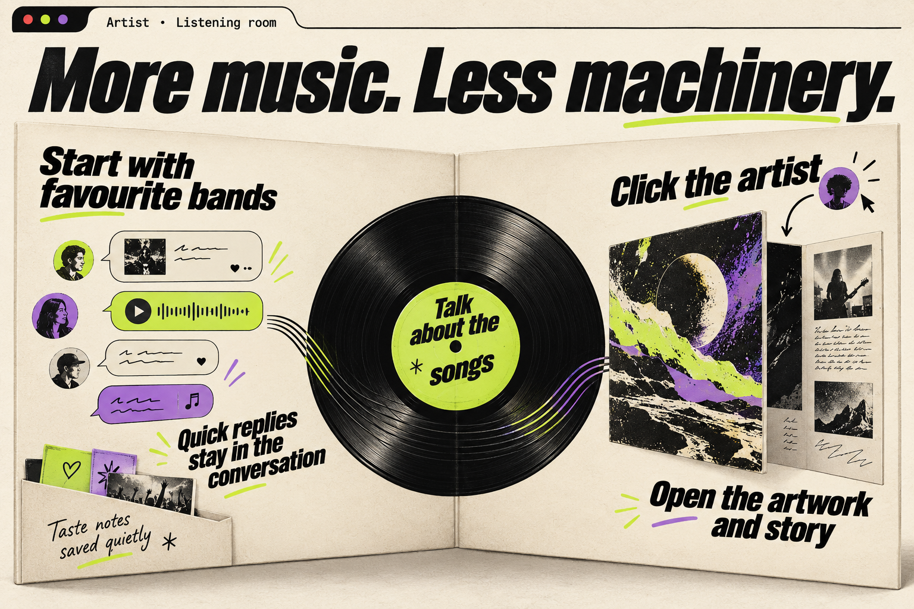
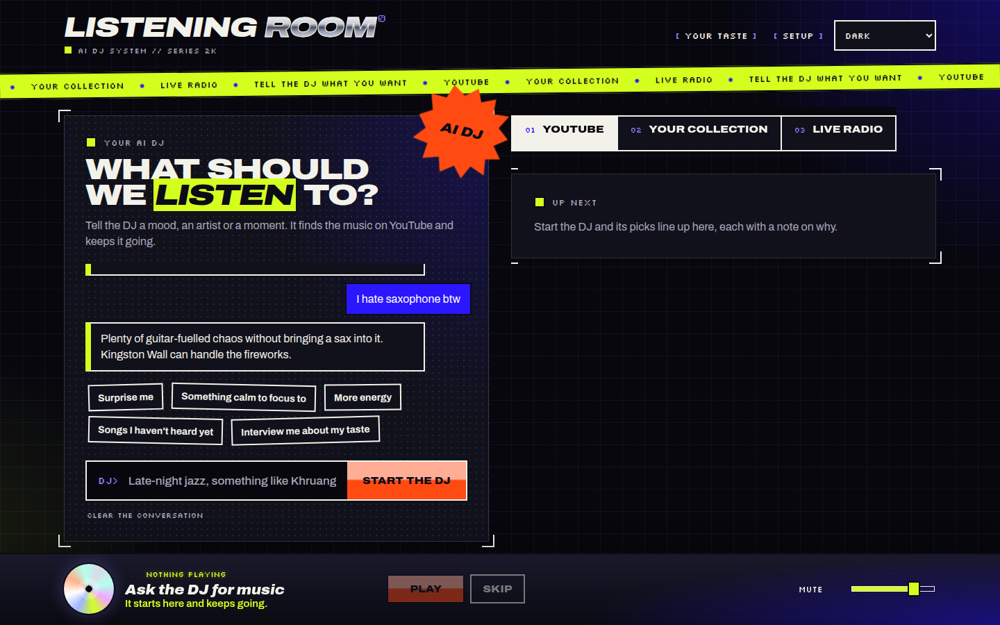
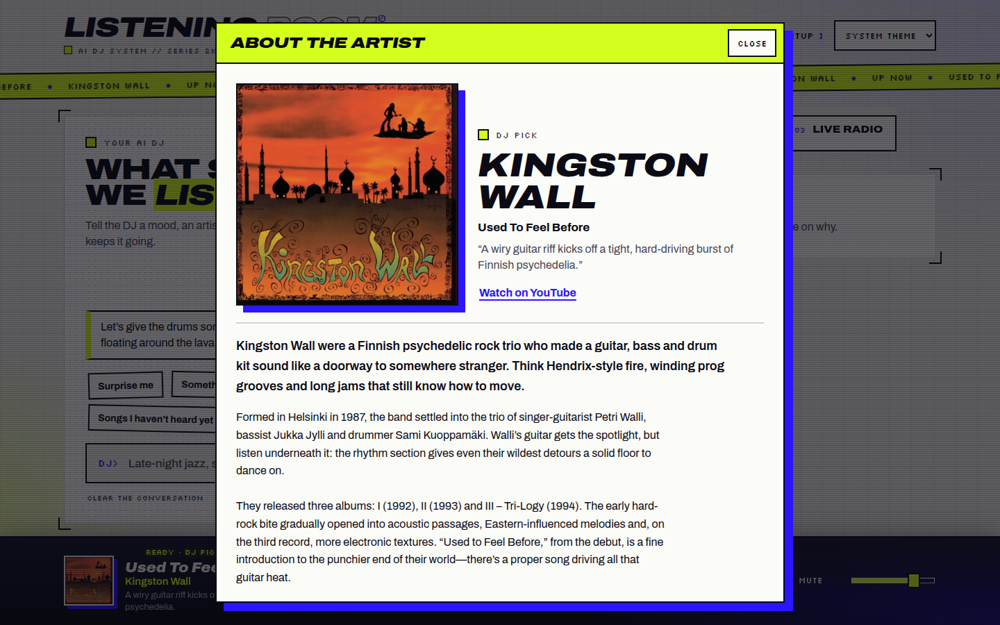
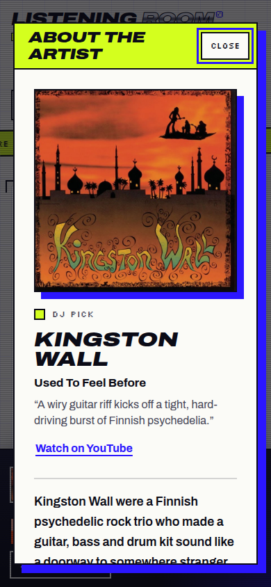

The DJ now starts with favourite bands, keeps note-taking out of the chat, and introduces songs by their sound. A wider conversation contains its quick replies, while clicking the now-playing artist opens larger artwork and artist notes; the browser tab names the artist.

What changed, how it works, and verification

This addresses all six items in the [request](input/0001-task.md), including the cramped chat shown in the [attached screenshot](input/attachments/image.png). Taste notes still save and remain manageable in **Your taste**, but the chat no longer announces them. Interview questions lead with bands and return to artists later. Shared prompt guidance gives replies and artist notes a relaxed DJ voice; song reasons focus on the recording rather than the listener's preferences.

The player artist name and cover open **About the artist**, replacing the local-track-only inline notes panel. It combines larger artwork, song context, the DJ's reason when present, a YouTube link for YouTube tracks, and generated artist notes. Notes load on opening and reuse the existing cache. Local tagged artists keep their IDs; YouTube and radio artists use a shared normalized name key, checked against the supplied name by the server. A song hint helps distinguish namesakes. The browser tab uses the artist, falling back to the song when unknown; system media controls retain the song title.

The Work, Evaluation and Gates contributions below all apply to product commit `7cb8a0d`, compared with run base `6df40ba4be24`. No product changes followed those checks. Local builds, typecheck and the server and web adapter suites passed, and real Codex and browser checks exercised the main journeys. The independent evaluator judged the result **good for internal testing**. Live-radio artist opening and chat during DJ playback remain unverified.

Review the prompt wording in [codex.ts](../../../apps/server/src/codex.ts), the artist identity and cache in [dj.ts](../../../apps/server/src/dj.ts), and the modal lifecycle and tab title in [main.tsx](../../../apps/web/src/main.tsx). The [CI failure record](../../test-failures/0011-improve-dj-interview-now-playing-and-response-ui.md) records the initial evidence review: no branch CI attempts or commit checks were found, which does not mean CI passed.

### Screenshots

Final product at `7cb8a0d`, captured by the runner browser without starting playback. These are running-app captures, separate from the conceptual infographic above.

### Conversation and DJ voice

The interview asks about favourite bands first; quick replies scroll with the conversation, and taste notes save quietly.

Conversation behavior and reviewer pointers

[DjPanel](../../../apps/web/src/dj-panel.tsx) removes the “Noted” chips and places suggestions at the end of the conversation list. [The stylesheet](../../../apps/web/src/style.css) widens the desktop DJ column and extends the chat into the panel's side padding. Notes can still be viewed and deleted in Your taste.

[Prompt guidance](../../../apps/server/src/codex.ts) asks one interview question at a time, builds on previous answers, and gives real-artist example replies. The interview wraps up after about six questions. Conversation and artist descriptions share voice guidance; YouTube picks and local candidate selection share a song-only reason instruction capped at 20 words. These are model instructions, so wording remains variable.

### Now playing and artist discovery

Click the artist or cover to open their story and larger artwork. The tab shows who is playing.

Artist window, identity and reviewer pointers

[PlayerBar](../../../apps/web/src/player-bar.tsx) exposes the artist as a keyboard-accessible button. [ArtistContent](../../../apps/web/src/dialogs.tsx) lays out the artwork and song context beside the artist name, with generated notes underneath and loading, unavailable and retry states. YouTube artwork requests the larger thumbnail and falls back to normal artwork. The window keeps the song context from when it was opened; Escape closes it and restores focus.

[main.tsx](../../../apps/web/src/main.tsx) connects the window to the existing artist-info job flow. [API handlers](../../../apps/server/src/index.ts) validate the optional name and song inputs. [Shared contracts](../../../packages/contracts/src/index.ts) provide name normalization and artist keys, also used by [YouTube media construction](../../../apps/server/src/youtube.ts). [The server test](../../../apps/server/test/dj.test.mjs) covers matching name keys, cache reuse, mismatched or missing names and empty normalized keys.

Radio songs with current track metadata use the same modal path, but that opening journey was not exercised with live playback. Radio does not gain artwork from this change.

### Accumulated phase contributions

Work pass 1 — implemented

Delivered all six requested changes in `7cb8a0d`: hidden note chips with notes preserved in Your taste; band-first interviews; an artist window for local, YouTube and radio song identities; artist-based tab titles; wider chat with suggestions inside its scroll area; and revised conversation, selection and artist-description prompts. Artist notes use validated normalized name keys for tracks without local ID3 identities and reuse the existing cache.

Reported passing: contracts build, workspace typecheck, server tests including the new name-keyed artist test, web adapter tests, and full build.

A separate server with real Codex and throwaway data ran a five-answer interview, a ten-track YouTube batch, and Kingston Wall artist notes. The interview built on named bands; all sampled pick reasons described the songs, for example “Insistent motorik drumming and fuzzed-out guitars turn repetition into mounting pressure.” A mismatched artist name returned unavailable.

Browser checks at 1440 × 900 and 390 × 844 confirmed the title “Kingston Wall · Listening room”, suggestions inside the conversation list, a 1280px source cover, generated notes, and Escape focus restoration. No audio was played. Opening from a live radio song and the DJ-on dark chat were not checked in this pass.

Evaluation pass 1 — good for internal testing

The independent evaluator assessed `7cb8a0d` against all six requests and the supplied screenshot, made no code changes, and judged it good for internal testing.

A ten-message conversation had no “Noted” text while five notes were saved. A real Codex interview opened with “Which bands or artists have you had on repeat lately?” and followed the answer about Can and Khruangbin. A taste-heavy request produced ten picks whose reasons stayed on the music. The evaluator found the DJ voice relaxed and witty, including “Office music doesn't have to sound like office furniture.”

The evaluator inspected the artist-window evidence: large cover, track reason, YouTube link, useful notes, mobile layout and Escape focus return. The dark desktop chat measured 586px within a 612px panel; quick replies were inside the scroll area, and mobile worked. The 269px desktop scroll-pane height shows roughly one exchange at a time. Once, an initial interview reply said “The music's on its way” without a music request; both observations were left as nonblocking.

DJ-on chat and live-radio artist opening remained unchecked. The evaluator's temporary server on port 8796 was stopped. Earlier dark-theme captures taken before persistent media emulation was verified were superseded by the final dark captures; the screenshot above uses the final conversation-bottom capture.

Gates pass 1 — passed, medium risk

Gates assessed `7cb8a0d` as medium risk because the feature crosses server, contracts and UI and adds name-keyed artist notes. Contracts build, typecheck, server tests, web adapter tests and full build all passed on the final product commit. [Review ranking](gate-check-results.md) found no smells, with top file risk 32.8/100. No fixes were required.

Code review checked name/key matching and rejection, updated callers, tab titles, removal of note chips and the suggestions' position. Security work was a manual review of artist inputs: zod validation and name/key checking. No automated security scan ran; no dependencies, sign-in, shell or file-access behavior changed. Gates accepted that an unchecked song hint could steer the notes cached for an artist in this local single-user app.

[Gate selections](gate-checks.json) explain the omitted checks: smoke was covered by Work and Evaluation on the same commit; full tests and build had already passed; no command or setting documentation needed updates; no design-system.json was present for a design-system check. Gates carried forward the two browser gaps rather than claiming them tested. No evidence became stale through later product edits, and release preparation did not repeat these checks.

