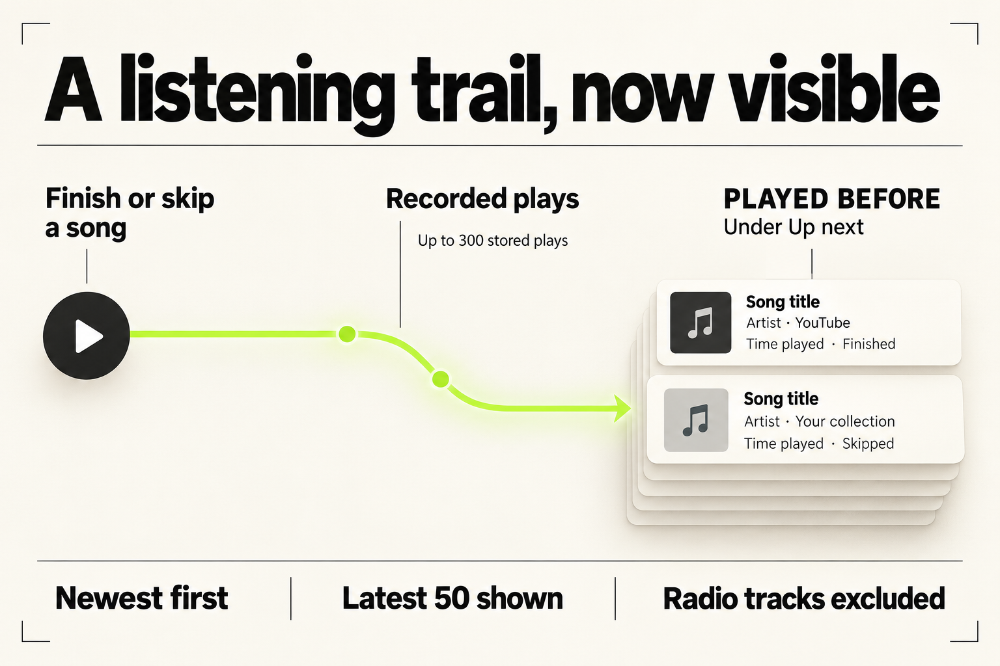
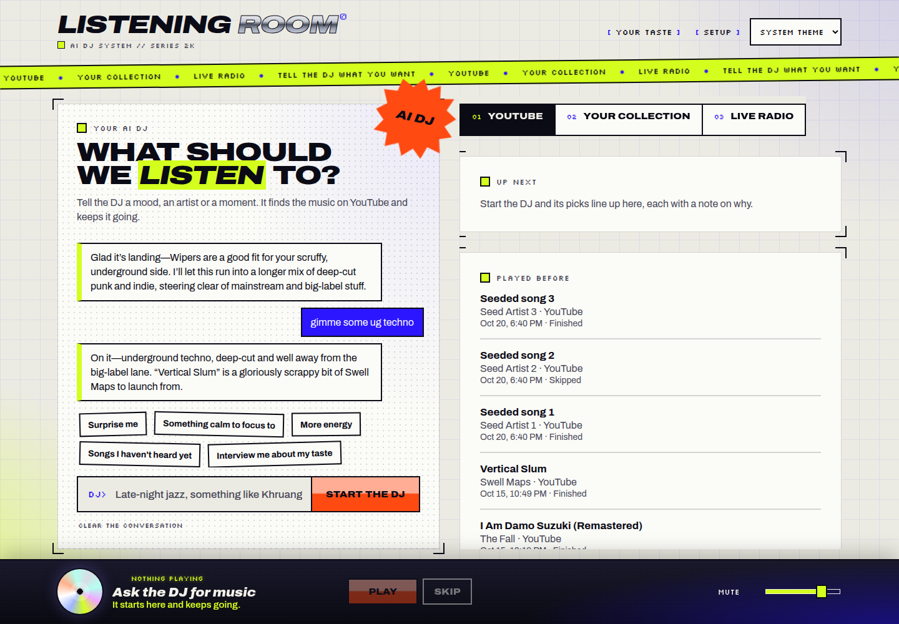
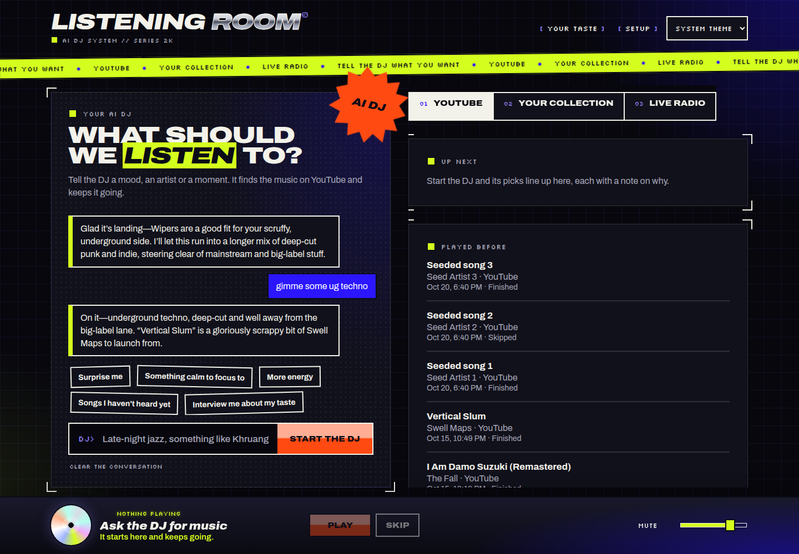
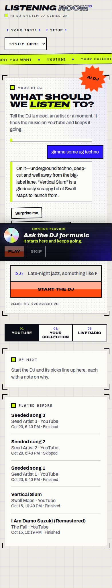

## TL;DR

Adds “Played before” under Up next so listeners can see their latest 50 recorded songs, newest first, with artist, source, time and Finished or Skipped status. A new read-only API exposes the existing play history; radio tracks remain excluded because they are not recorded as plays.

What changed, verification and review guide

The request was to see previously played songs. The server already kept up to 300 plays in `dj-memory.json`; this change makes that history visible without changing how plays are stored.

`GET /api/v1/dj/plays` returns `{ plays }` newest first. The web app loads history on startup and refreshes it after a successful listening report. The “Played before” card shows the newest 50 entries below Up next on the YouTube and Your collection views. Each row includes a title, artist (or “Unknown artist”), source, local date and time, and outcome. With no entries, it says “Songs you have listened to will show up here.” Liking and replaying from history are outside this change.

Start review with [HistoryPanel](../../../apps/web/src/panels.tsx), then its loading and refresh calls in [main.tsx](../../../apps/web/src/main.tsx). The route is in [server index.ts](../../../apps/server/src/index.ts), and its shared schema is in [contracts](../../../packages/contracts/src/index.ts). The [README](../../../README.md) describes the endpoint and view.

The final product code passed contracts build, workspace typecheck, server tests, web adapter tests and the full build. Evaluation judged it good for internal testing after checking seeded API ordering and the current UI on desktop light, desktop dark and mobile light. The release step reviewed the diff and opened every image included here; it made no product changes or additional product test runs.

Remaining verification limits: no browser check of the empty state, a refresh after real audio playback, collection-source labels, or scrolling to the final desktop row. The desktop screenshots clip the last visible row above the fixed player; evaluation found this consistent with existing column behavior. There is no direct test of the new route; existing memory tests cover the underlying read method.

CI is not yet verified. See the [CI test-failure record](../../test-failures/0012-show-previously-played-songs.md), which records the evidence reviewed and will retain any failures found during release.

## Screenshots

Captured by the evaluator from the current build with seeded history and without starting audio. These are actual app screenshots; the infographic above is an explanatory illustration.

Desktop, light theme:

Desktop, dark theme:

Mobile, light theme (full page):

## Listening history in the web app

The listener can see which songs finished or were skipped, with the most recent plays at the top.

Display and refresh behavior

[panels.tsx](../../../apps/web/src/panels.tsx) adds an accessible heading and a list using the existing catalog styling. Dates use the browser's locale. Sources display as “YouTube” or “Your collection”. [style.css](../../../apps/web/src/style.css) adds muted styling for the time and outcome line.

[main.tsx](../../../apps/web/src/main.tsx) validates the API response with the shared contract, stores the plays in React state, fetches on startup and refreshes after the existing listening POST succeeds. History is read-only and shows up to 50 entries.

## API, contract and documentation

The new endpoint exposes up to 300 existing records without changing the stored order.

How the data reaches the list

The [server route](../../../apps/server/src/index.ts) reverses the copy returned by `recentPlays(300)`, leaving the stored list unchanged. [Contracts](../../../packages/contracts/src/index.ts) adds `playedTrack`, `playHistory` and `PlayedTrack`, matching the stored play fields: media ID, source, title, nullable artist, outcome, listened seconds, nullable duration seconds and timestamp.

The [README](../../../README.md) documents the route and view and explicitly notes that radio songs are excluded. Existing recording and retention behavior stays in place.

## Accumulated phase reports

Work, Evaluation and Gates each completed one pass. Their evidence applies to the final product code: no product code changed after gates or during release preparation.

Work pass 1 — implemented

Delivered the shared contracts, `GET /api/v1/dj/plays`, the “Played before” card under Up next, refresh after play reports, styling and README documentation. The API returns up to 300 recorded plays newest first; the UI shows the newest 50 with title, artist, source, time and outcome, plus an empty state.

Build, typecheck and workspace tests passed. Work did not run the browser, so layout and themes were initially unchecked; Evaluation later supplied that evidence. Radio was deliberately left out because it is not recorded as plays today. Like and replay actions were not added.

Evaluation pass 1 — good for internal testing

Evaluation confirmed the goal was met, seeded three plays and checked API ordering. It opened the current build's desktop light, desktop dark and mobile light screenshots. Dark mode was confirmed with `matchMedia`.

The card fits the existing Up next styling, with the same markers, headings, corner brackets and type scale. Titles are bold, details muted, rows separated and spacing comfortable. Contrast was good in both themes, and mobile stacked cleanly. Up next and the DJ panel were unchanged. The last desktop row's metadata was clipped at the column bottom above the fixed player, consistent with existing column behavior; scrolling to that row was not verified.

Evaluation accepted the 50-entry limit, exclusion of radio plays and absence of like or replay actions. It did not verify the empty state in the app, refresh after a real track ends, or collection-source labels. It made no fixes and left automated checks to Gates.

Gates pass 1 — passed, medium risk

Gates classified the read-only API, shared contract and UI addition as medium risk. Contracts build, all-workspace typecheck, server tests, web adapter tests and the full build passed on the final checkout. The review ranking check passed; the highest file risk was about 20/100. Its only reported smell was the existing size of `main.tsx`.

Code review confirmed that reversing `recentPlays` does not mutate storage, the contract matches stored records, and the UI handles an empty list and missing artist and refreshes after reporting a play. No direct route test was added; existing memory tests cover the read method. No fixes were needed.

There are no project lint or formatting scripts, so those checks were not run. Smoke was not repeated because Evaluation checked the unchanged current build. Full tests were not repeated beyond the server and web suites already run. No separate security check ran: the change adds no authentication, input handling, shell or file access, or dependencies. No design-system check ran because the task has no `design-system.json`. No additional documentation check ran because the README already described the view and endpoint.

The browser limits from Evaluation remain open. See [gate check results](gate-check-results.md) and [gate selections](gate-checks.json) for the saved gate artifacts. Local gates do not establish a CI result.

